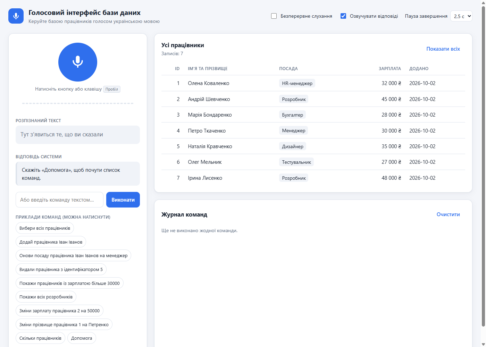
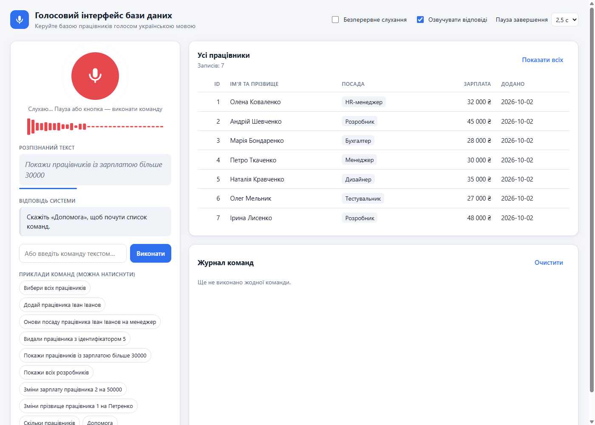
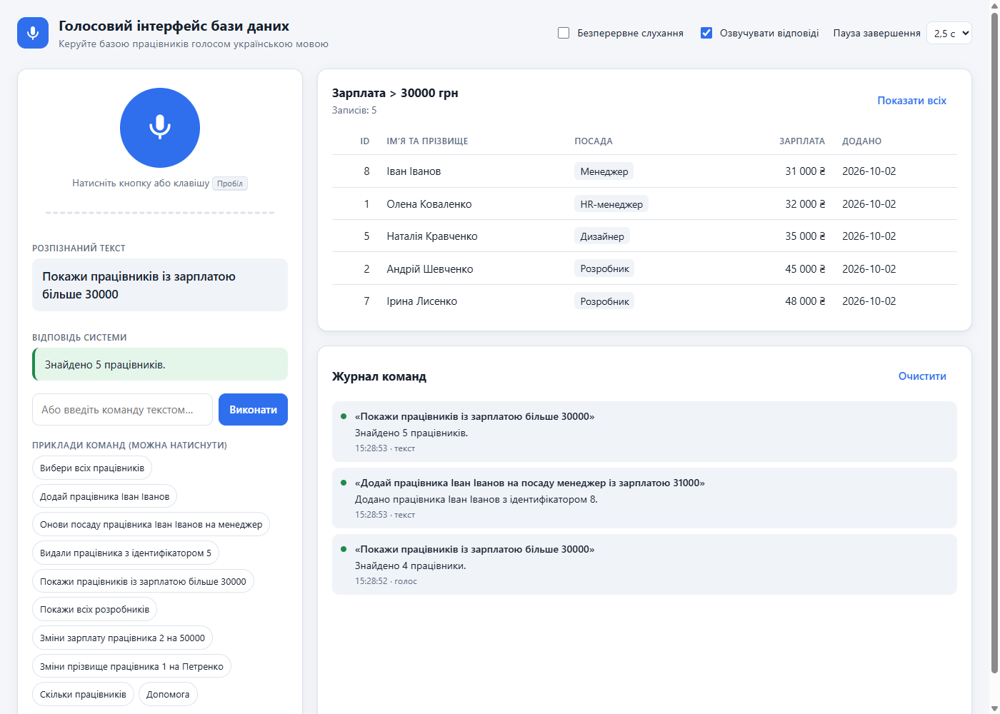
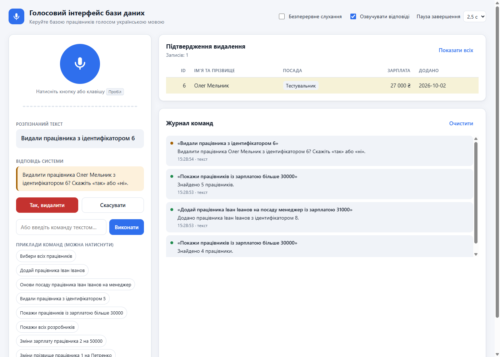
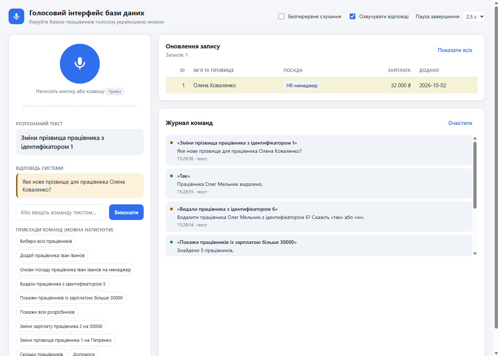
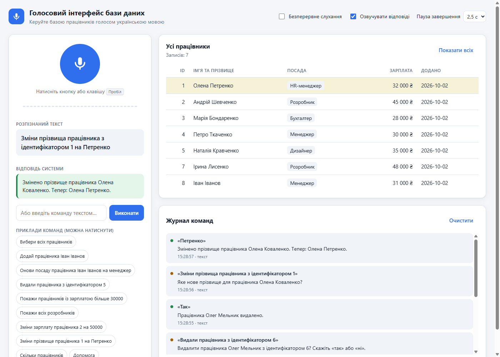

# Звіт з лабораторної роботи №1

**Тема:** Розробка інноваційного голосового інтерфейсу для управління базою даних

| | |
|---|---|
| Дисципліна | ____________________ |
| Виконав(ла) | студент(ка) групи ______, ____________________ |
| Перевірив(ла) | ____________________ |
| Дата | ____________________ |

---

## 1. Мета роботи

Розробити застосунок, у якому користувач керує базою даних голосовими командами: вибирає, додає, оновлює й видаляє записи. Також дослідити, як голос як основний засіб керування робить роботу з даними зручнішою.

## 2. Постановка завдання

Розроблено **вебзастосунок для голосового керування базою працівників**. Він має:

- розпізнавати голосові команди українською мовою;
- перетворювати розпізнаний текст на запити до БД (CRUD-операції);
- перевіряти коректність команд і повідомляти про помилки;
- відповідати голосом і текстом, показувати результат у таблиці;
- підтримувати команди-приклади із завдання:
  - «Вибери всіх працівників»;
  - «Додай працівника Іван Іванов»;
  - «Онови посаду працівника Іван Іванов на менеджер»;
  - «Видали працівника з ідентифікатором 5».

## 3. Вибір технологій та обґрунтування

| Компонент | Обрана технологія | Обґрунтування |
|---|---|---|
| Тип застосунку | Вебзастосунок | Працює на будь-якій ОС і на телефоні без встановлення. Браузер уже вміє працювати з мікрофоном, розпізнавати й синтезувати мовлення. |
| Розпізнавання мовлення | **Web Speech API** (`SpeechRecognition`, мова `uk-UA`) | Безкоштовний, підтримує українську мову, показує проміжні результати в реальному часі. Ключі API не потрібні, тож їх неможливо «злити» з клієнтського коду. У Chrome розпізнавання виконують хмарні сервіси Google, тому точність така сама, як у платних хмарних API. |
| Захоплення аудіо | **Web Audio API** (`getUserMedia`, `AnalyserNode`) | Показує рівень сигналу мікрофона. Вмикає вбудовані в браузер шумозаглушення, ехоподавлення й автопідсилення. |
| Синтез мовлення | `SpeechSynthesis` + серверний синтез (Google Translate TTS) | Система відповідає голосом, тож дивитися на екран не обов’язково. Серверний синтез потрібен, бо в Chrome на Windows немає українського голосу (детальніше в розд. 8.3). |
| Сервер | **Node.js 24 + Express** | Клієнт і сервер написані однією мовою (JavaScript), сервер мінімальний. |
| База даних | **SQLite** (вбудований модуль `node:sqlite`) | Уся база в одному файлі, без окремого сервера БД і без компіляції нативних модулів. Для навчального застосунку цього вистачає з запасом. |
| Доступ до БД | Прямий SQL через **підготовлені (параметризовані) запити** | Запитів небагато, і вони прості, тому ORM тут зайвий. Параметризація захищає від SQL-ін’єкцій. |
| Обробка команд | **Регулярні вирази + простий стемінг для української** | Результат передбачуваний, працює миттєво й офлайн, кожне правило легко пояснити. Повноцінна NLP-бібліотека (spaCy, NLTK) для набору CRUD-команд надлишкова. |
| Тестування | `node:test` (модульні тести) + Chrome headless через протокол DevTools (CDP) | Модульні тести перевіряють розбір команд і роботу з БД. Браузерні тести перевіряють поведінку голосового інтерфейсу. |

**Порівняння з альтернативами.**
- **Хмарні сервіси** (Azure Speech, Google Cloud Speech-to-Text) розпізнають так само точно, але потребують реєстрації, ключа API й оплати.
- **Офлайн-бібліотеки** (Vosk, DeepSpeech) працюють без інтернету й не передають голос стороннім сервісам. Натомість їм потрібна окрема модель (~50 МБ і більше), а для української мови вони розпізнають гірше.

Для лабораторної роботи обрано Web Speech API як оптимальний баланс точності й простоти. Перехід на Vosk описано в розділі 11 як можливе розширення.

## 4. Архітектура застосунку

```
Браузер (клієнт)                                    Сервер (Node.js)
┌────────────────────────────────────────┐         ┌──────────────────────────────────────┐
│ Мікрофон → Web Speech API (uk-UA)      │  текст  │ POST /api/command                    │
│   • проміжний текст на екрані          │ ──────► │   parser.js   — нормалізація, regex   │
│   • до 3 варіантів розпізнавання       │         │   executor.js — валідація, логіка    │
│   • кінець фрази — за паузою           │ ◄────── │   db.js       — SQLite, SQL-запити    │
│ Web Audio API → індикатор, сигнал      │  JSON   │ GET  /api/employees                  │
│ Озвучення відповіді, таблиця, журнал   │ ◄────── │ GET  /api/tts — українське мовлення   │
└────────────────────────────────────────┘   MP3   └──────────────────────────────────────┘
```

### Структура проєкту

| Файл | Призначення | Рядків |
|---|---|---|
| `server.js` | HTTP-сервер (Express), REST API | 57 |
| `src/parser.js` | нормалізація тексту, числівники, розбір команд | 236 |
| `src/executor.js` | виконання команд, валідація, тексти відповідей | 174 |
| `src/db.js` | схема БД, початкові дані, запити, стемінг | 107 |
| `src/tts.js` | серверний синтез української мови з кешем | 49 |
| `public/index.html`, `style.css` | інтерфейс (світла й темна теми, адаптивна верстка) | 421 |
| `public/app.js` | розпізнавання, діалог, озвучення, таблиця | 764 |
| `test/*.test.js` | модульні тести | 220 |

### Схема бази даних

```sql
CREATE TABLE employees (
  id         INTEGER PRIMARY KEY AUTOINCREMENT,
  name       TEXT    NOT NULL,
  position   TEXT    NOT NULL DEFAULT 'Не вказано',
  salary     INTEGER,
  created_at TEXT    NOT NULL DEFAULT (datetime('now', 'localtime'))
);
```

Під час першого запуску в базу додаються 7 тестових працівників.

## 5. Хід роботи

### 5.1. Налаштування середовища

1. Встановлено Node.js 24 і npm. Проєкт створено у VS Code.
2. Встановлено залежність `express`. SQLite підключено через вбудований модуль `node:sqlite`, тож окремо встановлювати його не потрібно.
3. Сервіс розпізнавання не потребує реєстрації чи ключів: Web Speech API вбудований у Chrome та Edge.

### 5.2. Захоплення аудіо та розпізнавання мовлення

- Розпізнавання налаштовано на мову `uk-UA` з проміжними результатами (`interimResults`) і трьома варіантами розпізнавання (`maxAlternatives = 3`).
- **Кінець команди визначає сам застосунок.** Chrome обриває фразу вже після ~1 с тиші, через що довгі команди обрізалися. Тому розпізнавання працює в безперервному режимі (`continuous = true`), а застосунок збирає фразу з окремих шматків. Команда вважається завершеною:
  - після паузи заданої тривалості (налаштовується: 1,5 / 2,5 / 4 / 6 с, типово 2,5 с);
  - або після повторного натискання кнопки мікрофона.

  Смужка під розпізнаним текстом показує, скільки лишилося до виконання.
- **Сигнал «можна говорити».** Коли вмикається мікрофон, лунає короткий тон (генератор Web Audio API), а індикатор показує рівень звуку.
- **Мікрофон вмикається й вимикається асинхронно.** Повторний `start()` до завершення попередньої сесії браузер відхиляє. Тому натискання в цей момент ставиться в чергу. Якщо браузер так і не повідомив про старт, сторожовий таймер через 3 с створює нову сесію розпізнавання.

### 5.3. Обробка команд

Обробка складається з кількох етапів:

1. **Вибір варіанта.** Сервер бере перший із варіантів розпізнавання, який вдається розібрати як команду. Тому помилка в одному слові часто не заважає.
2. **Нормалізація.** Текст переводиться в нижній регістр, прибирається пунктуація, різні апострофи (`’ ʼ '`) зводяться до одного. Числа з пробілами склеюються («20 000» стає «20000»).
3. **Числівники.** Слова замінюються цифрами: «двадцять п’ять тисяч» стає «25000», «п’ять» стає «5».
4. **Розбір шаблонами** (регулярні вирази з підтримкою Unicode). Система розуміє синоніми дієслів, відмінкові форми, жіночий рід, формулювання з «яких», «у яких», «які отримують». Результат — структурована команда, наприклад:
   ```js
   parseCommand('Онови посаду працівника Іван Іванов на менеджер')
   // → { intent: 'update', target: { name: 'іван іванов' }, field: 'position', value: 'Менеджер' }
   ```
5. **Пошук працівника за ім’ям у будь-якому відмінку.** Простий стемінг відкидає закінчення, тому «Івана Іванова» знаходить «Іван Іванов».
6. **Виконання.** Значення перевіряються, і для потрібної операції виконується параметризований SQL-запит.

### 5.4. Голосовий діалог

- **Підтвердження видалення.** Система коротко питає «Видалити Олег Мельник? Так чи ні?» і сама вмикає мікрофон. Вона розуміє різні варіанти відповіді:
  - згода: «так», «звісно», «ага», «да»;
  - відмова: «ні», «не треба», «скасуй».

  Нерозбірливу відповідь система перепитує. Після трьох пауз без відповіді видалення скасовується.
- **Уточнення значення.** Якщо в команді немає нового значення («Зміни прізвище працівника 1»), система питає «Яке нове прізвище для працівника Олена Коваленко?» і чекає відповіді.
- **Масове видалення** («видали всіх») заборонене з міркувань безпеки.

### 5.5. Інтерфейс

**Головний екран.** Ліворуч — керування голосом, праворуч — дані та журнал команд:



**Прослуховування.** Видно проміжний текст, індикатор рівня звуку і смужку відліку паузи:



**Вибірка за умовою** («Покажи працівників із зарплатою більше 30000»):



**Підтвердження видалення:**



**Уточнення значення.** Система питає нове прізвище:



**Результат оновлення.** Змінилося тільки прізвище, рядок підсвічено:



## 6. Підтримувані голосові команди

| Операція | Приклади фраз |
|---|---|
| Вибірка всіх | «Вибери всіх працівників», «Покажи всіх співробітників», «Список працівників» |
| Пошук | «Знайди працівника Андрій Шевченко», «Покажи працівника з ідентифікатором 3» |
| Фільтр за посадою | «Покажи всіх розробників», «Покажи працівників з посадою менеджер» |
| Фільтр за зарплатою | «…із зарплатою більше 30000», «…зарплати яких більше 40 000», «…у яких зарплата понад сорок тисяч», «…які отримують менше 30000» |
| Додавання | «Додай працівника Іван Іванов», «Додай працівника Дар’я Петренко на посаду бухгалтер із зарплатою 30 тисяч» |
| Оновлення | «Онови посаду працівника Іван Іванов на менеджер», «Зміни зарплату працівника 2 на 50000», «Зміни прізвище працівника 1 на Петренко», «Зміни ім’я працівниці 1 на Ольга» |
| Видалення | «Видали працівника з ідентифікатором 5», «Видали працівника Олег Мельник», після чого треба відповісти «так» |
| Службові | «Скільки працівників», «Допомога» |

## 7. Безпека

| Загроза | Захист |
|---|---|
| SQL-ін’єкції | Усі запити параметризовані, а назви колонок для оновлення беруться з білого списку. Окремий тест перевіряє спробу ін’єкції. |
| Некоректні дані | Ім’я та посада можуть містити лише літери, пробіл, дефіс і апостроф (від 2 до 80 символів). Зарплата — ціле число від 0 до 10 000 000. |
| Перевантаження запитами | Довжина команди обмежена 300 символами, тіло запиту — 4 КБ. |
| XSS | Дані вставляються в сторінку лише через `textContent`. |
| Випадкове видалення | Обов’язкове підтвердження. Масове видалення заборонене. Якщо під ім’я підходять кілька працівників, система просить уточнити ідентифікатор. |
| Витік ключів API | Ключі не потрібні. Якщо перейти на платний сервіс, ключ слід зберігати на сервері у файлі `.env` (він уже доданий у `.gitignore`). |
| Самопрослуховування | Під час озвучення відповіді мікрофон вимкнено, щоб система не виконала команду, почуту від самої себе. |

## 8. Тестування

### 8.1. Модульні тести (`npm test`)

**20 тестів, усі пройдено** (час виконання ~0,15 с). Вони перевіряють:

- нормалізацію тексту й перетворення числівників на цифри;
- усі приклади команд із завдання та їхні варіації (синоніми, відмінки, жіночий рід);
- фільтри вибірки за id, ім’ям, посадою і зарплатою (11 формулювань для зарплати);
- повний цикл «додати, оновити, видалити з підтвердженням» на базі в пам’яті;
- зміну лише імені або лише прізвища, а також команду без значення з подальшим уточненням;
- некоректні та небезпечні команди: масове видалення, цифри в імені, SQL-ін’єкцію;
- вибір правильного варіанта серед кількох варіантів розпізнавання;
- поділ довгого тексту для синтезу мовлення.

### 8.2. Автоматизовані браузерні сценарії

Сценарії запускалися в Chrome без вікна (headless) і без звуку, з керуванням через протокол DevTools. Розпізнавання мовлення імітувалося: тест «говорить» фрази. Імітація відтворює поведінку Chrome — асинхронне ввімкнення й вимкнення мікрофона, помилку при повторному старті, шматки фрази.

| Група | Сценарій | Результат |
|---|---|---|
| Підтвердження | «Так, видалити» / «Да» / «ні не треба» | ✔ видалено / ✔ видалено / ✔ скасовано |
| | «мм» (нерозбірливо), потім «так» | ✔ перепитала, потім видалила |
| | тиша тричі | ✔ скасовано |
| | «так» лише в другому варіанті розпізнавання | ✔ видалено |
| Пауза | «Видали працівника» … пауза 1,8 с … «з ідентифікатором 7» | ✔ одна команда, не обірвалась |
| | кнопка мікрофона завершує команду | ✔ за 66 мс |
| | налаштування 6 с, пауза 4 с посеред фрази | ✔ дочекалася кінця |
| | тиша 10 с | ✔ «Мовлення не виявлено» |
| Уточнення | «Зміни прізвища працівника 1», потім «Петренко» | ✔ Олена Петренко |
| | «Зміни імя працівниці 1», потім «скасуй» | ✔ без змін |
| | «Зміни прізвище працівника 1 на Коваленко» (одразу зі значенням) | ✔ змінено |
| Пауза | лише проміжний (незавершений) результат + пауза | ✔ виконано |
| Фільтри | «покажи працівників і зарплатою більше 40 000» | ✔ 2 записи |
| | «покажи всіх працівників зарплати яких більше 40 000» | ✔ 2 записи |
| Кнопка мікрофона | повторне натискання одразу після команди | ✔ мікрофон увімкнувся за 0,4 с |
| | Пробіл, коли фокус на іншій кнопці | ✔ працює |
| | натискання під час обробки команди / під час озвучення | ✔ / ✔ |
| | подвійне швидке натискання | ✔ кнопка не «застрягає» |
| | браузер не повідомив про старт сесії | ✔ нова сесія за 3,8 с |

### 8.3. Тестування голосом і виправлені проблеми

Під час ручного тестування голосом у Chrome виявлено й виправлено такі проблеми:

| № | Проблема | Причина | Рішення |
|---|---|---|---|
| 1 | Відповіді озвучувалися з російською вимовою | У Windows встановлено лише російський та англійський голоси, і Chrome читав український текст російським | Додано серверний синтез українського мовлення (`/api/tts`) з кешем. Якщо в браузері є український голос (наприклад, у Microsoft Edge), використовується він. |
| 2 | Відповідь «так» на підтвердження видалення не зараховувалась | Поки звучало довге питання, мікрофон був вимкнений (~8 с), і відповідь губилася | Питання скорочено до «Видалити …? Так чи ні?», додано звуковий сигнал, розширено словник відповідей. Мікрофон тепер вмикається через ~3 с. |
| 3 | Команда «Зміни прізвища працівника з ідентифікатором 1» не розпізнавалась | Розпізнавач повернув форму «прізвища», а в команді не було нового значення | Додано всі форми слів «ім’я» та «прізвище» і зміну лише частини імені. Якщо значення немає, система його перепитує. |
| 4 | Довгі команди обривалися на паузі | Chrome завершує фразу після ~1 с тиші | Безперервний режим із власним визначенням паузи (2,5 с, налаштовується) і відліком на екрані |
| 5 | Не розпізнавались «…і зарплатою більше…», «…зарплати яких більше…» | Розпізнавач чує «і» замість «із». Шаблон охоплював не всі формулювання | Шаблон фільтра розширено (відносні звороти, «у яких», «які отримують», «не менше», «рівно») |
| 6 | Кнопка мікрофона іноді не спрацьовувала | Повторний старт до завершення попередньої сесії відхилявся без повідомлення. Пробіл натискав кнопку, на якій був фокус. Озвучення вимикало щойно ввімкнений мікрофон. | Натискання ставиться в чергу, додано сторожовий таймер, Пробіл обробляється глобально, після відповіді мікрофон вмикається знову |

### 8.4. Розпізнавання в різних умовах

> Таблицю заповнює автор роботи за результатами власних перевірок.

| Умови | Точність розпізнавання (вдалих команд / спроб) | Примітки |
|---|---|---|
| Тиха кімната, чітка вимова | ___ / ___ | |
| Фоновий шум (музика, розмова) | ___ / ___ | |
| Інший голос / акцент / швидкий темп | ___ / ___ | |
| Числа словами й цифрами | ___ / ___ | |

### 8.5. Кросплатформеність

| Браузер | Розпізнавання голосу | Озвучення |
|---|---|---|
| Google Chrome (Windows) | ✔ (перевірено) | ✔ через серверний синтез |
| Microsoft Edge | ✔ (Azure Speech) | ✔ вбудований український голос |
| Mozilla Firefox | ✘ Web Speech API не підтримується | працює текстове введення команд |

## 9. Оптимізація

| Що виміряно | До | Після |
|---|---|---|
| Час до ввімкнення мікрофона для відповіді «так/ні» | ~8 с | ~3 с |
| Отримання озвученої фрази з сервера | ~0,5 с | 3 мс для повторної фрази (кеш на 100 фраз) |
| Виконання команди після її завершення кнопкою | — | ~70 мс |

Також розпізнавання враховує до трьох варіантів фрази, а в браузері ввімкнено шумозаглушення й ехоподавлення мікрофона.

## 10. Запуск

```bash
npm install
npm start          # http://localhost:3000
npm test           # модульні тести
```

Потрібні Node.js 22.13 або новіший і браузер Chrome чи Edge. Для доступу до мікрофона з іншого комп’ютера застосунок потрібно розгорнути з HTTPS, наприклад на Render, Railway або Azure App Service.

## 11. Можливі розширення

- **Офлайн-розпізнавання через Vosk** (модель `vosk-model-uk`). Аудіо з `getUserMedia` (PCM, 16 кГц) передається на сервер через WebSocket. Застосунок працюватиме без інтернету, а голос не залишатиме комп’ютер.
- **NLP-розбір** (spaCy, модель `uk_core_news`) для довільніших формулювань і приведення імен до називного відмінка.
- **Кілька таблиць** (товари, клієнти). Нові сутності додаються окремими шаблонами без зміни решти коду.

## 12. Висновки

1. Розроблено вебзастосунок, у якому базою працівників повністю керують голосом українською мовою. Підтримуються вибірка (зокрема з фільтрами), додавання, оновлення й видалення записів. Усі приклади команд із завдання працюють.
2. Розпізнавання реалізовано через Web Speech API, без ключів і без оплати. Тексти команд обробляються регулярними виразами з нормалізацією, перетворенням числівників і стемінгом. Цього достатньо для надійного розбору команд з урахуванням варіацій мовлення.
3. Голосовий інтерфейс має свої особливості, яких немає в звичайному графічному інтерфейсі. Потрібно визначати кінець фрази, підтверджувати небезпечні дії, уточнювати відсутні дані і не допускати, щоб система розпізнавала власний голос. Найбільше покращень з’явилося саме після тестування реальним голосом (розд. 8.3).
4. Безпеку забезпечують параметризовані запити, валідація, обов’язкове підтвердження видалення й відсутність ключів у клієнтському коді.
5. Якість підтверджено 20 модульними тестами та 22 автоматизованими браузерними сценаріями. Усі вони пройдені.
