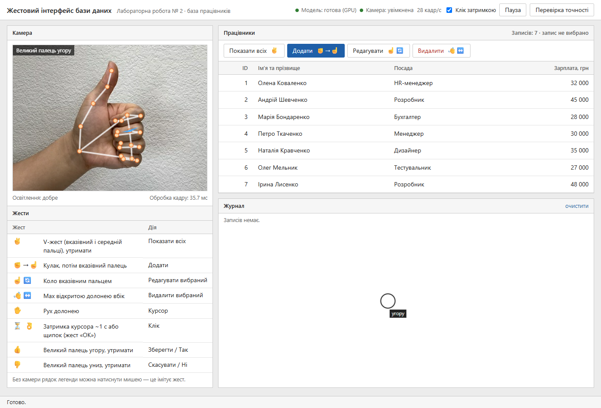
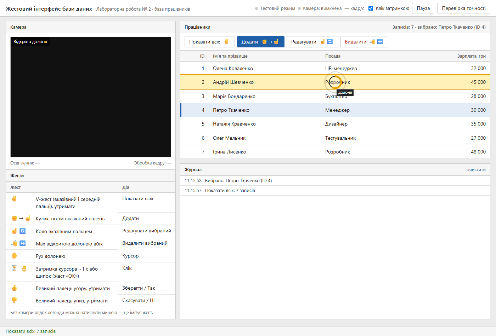
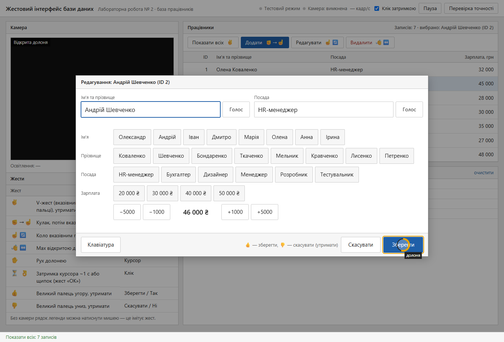
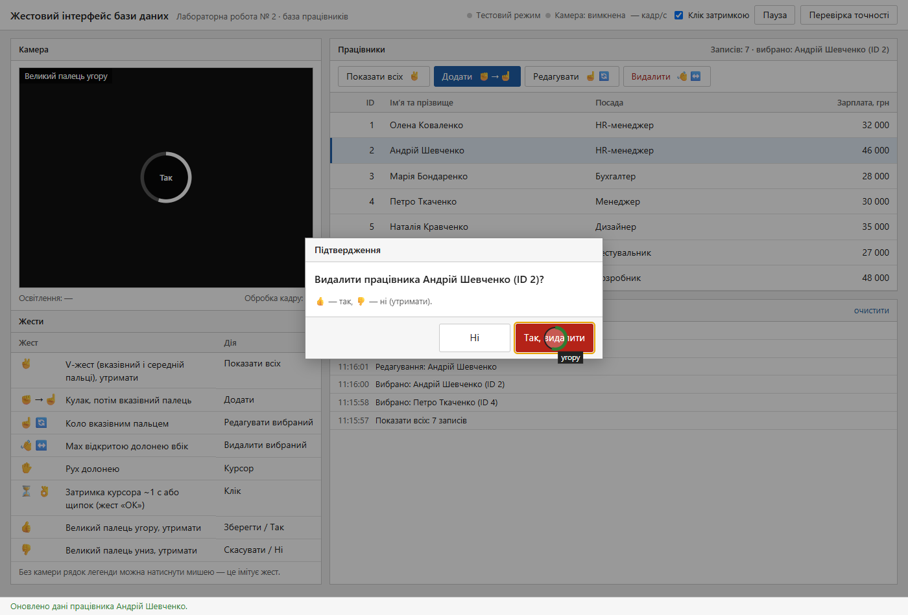
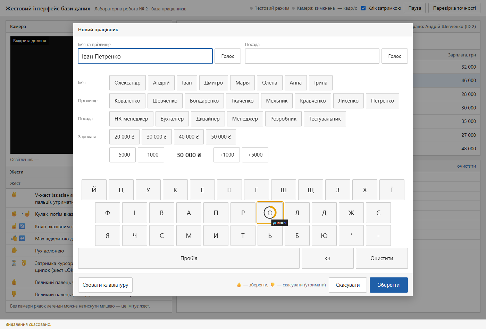
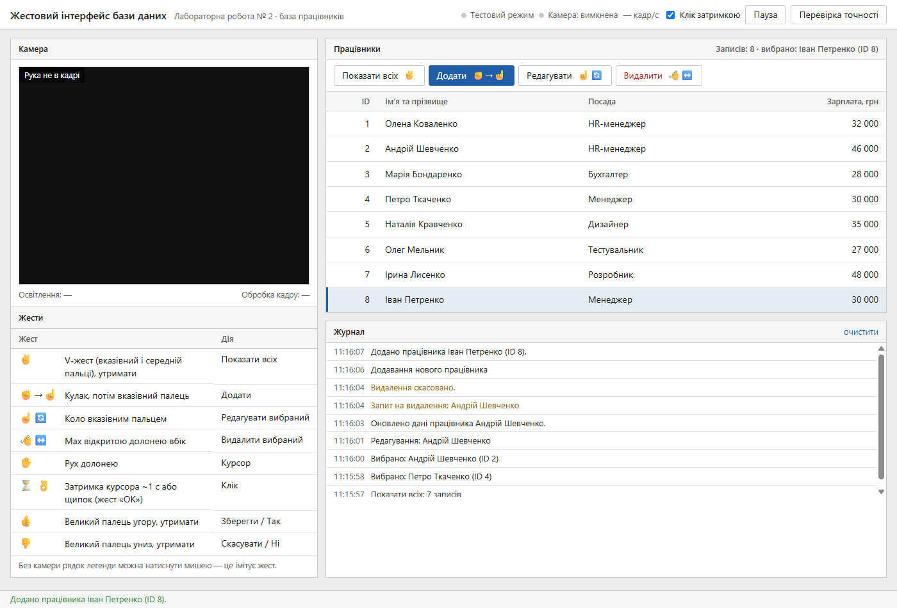
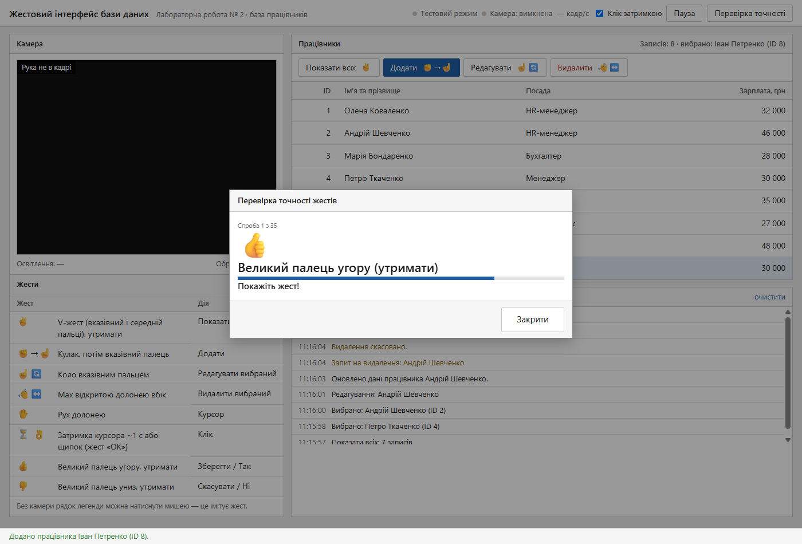

# Звіт з лабораторної роботи №2

**Тема:** Розробка інноваційного жестового інтерфейсу для управління базою даних

| | |
|---|---|
| Дисципліна | ____________________ |
| Виконав(ла) | студент(ка) групи ______, ____________________ |
| Перевірив(ла) | ____________________ |
| Дата | ____________________ |

---

## 1. Мета роботи

Розробити застосунок, у якому користувач керує базою даних жестами руки перед камерою, без контакту з клавіатурою та мишею. Застосунок має підтримувати вибірку, додавання, оновлення й видалення записів. Також потрібно дослідити, як жести як основний засіб керування змінюють взаємодію з даними, і використати безкоштовні засоби розпізнавання.

## 2. Постановка завдання

Розроблено **вебзастосунок для керування базою працівників жестами**. Він має:

- захоплювати відео з вебкамери й розпізнавати руку в реальному часі;
- перетворювати жести на команди й виконувати операції з БД (CRUD);
- запитувати підтвердження перед небезпечними діями та перевіряти коректність даних;
- давати змогу вводити дані без клавіатури;
- вимірювати точність розпізнавання жестів (вимога завдання — понад 90 %).

**Адаптація жестів із завдання.** Завдання пропонує жести як приклад, який можна змінювати. Остаточний набір визначено за результатами тестування живою рукою:

| Пропозиція в завданні | Реалізація | Причина зміни |
|---|---|---|
| Мах рукою вгору — «Вибери всіх» | **V-жест, утримати ~0,6 с** | Мах угору спрацьовував щоразу, коли людина просто піднімала руку в кадр. Статичний V-жест модель розпізнає надійно, і випадково його не покажеш. |
| Кулак з вказівкою пальцем — «Додай» | **Кулак, потім вказівний палець** | Без змін (послідовність двох поз) |
| Кругові рухи рукою — «Онови» | **Коло вказівним пальцем** | Без змін |
| Мах рукою вбік — «Видали» | **Мах відкритою долонею вбік + підтвердження** | Додано обов’язкове підтвердження |
| «Подальше введення даних через інші жести» | **Курсор долонею, клік затримкою або щипком; великий палець угору / униз** | Див. розділ 5.5 |

## 3. Вибір технологій та обґрунтування

| Компонент | Обрана технологія | Обґрунтування |
|---|---|---|
| Тип застосунку | **Вебзастосунок** | Працює на будь-якій ОС без встановлення. Браузер має доступ до камери (MediaStream API) і до відеокарти (WebGL). |
| Розпізнавання руки | **Google MediaPipe Gesture Recognizer** (`@mediapipe/tasks-vision`) | Безкоштовний, з відкритим кодом (Apache 2.0). Працює локально через WebAssembly + GPU у реальному часі. Повертає 21 ключову точку руки і класифікує 7 статичних жестів. Відео не залишає комп’ютер, ключі API не потрібні. |
| Захоплення відео | `getUserMedia` (MediaStream API), 640×480, 30 кадр/с | Стандартний API браузера, без додаткових бібліотек |
| Рухові жести | **Власний рушій правил** (`gestures.js`) | Мах, коло й послідовність «кулак → палець» визначаються за траєкторіями точок руки. Правила прозорі, налаштовуються параметрами й покриті тестами. |
| Сервер | **Node.js + Express** | Мінімальний REST API. Також сервер роздає бібліотеку MediaPipe і модель локально, без CDN. |
| База даних | **SQLite** (вбудований модуль `node:sqlite`) | Уся база в одному файлі, без окремого сервера БД |
| Доступ до БД | Прямий SQL через параметризовані запити | Запитів чотири, ORM зайвий. Параметризація захищає від SQL-ін’єкцій. |
| Голосове введення (додатково) | Web Speech API | Гібридний інтерфейс: ім’я можна надиктувати (технологія з лабораторної №1) |

**Порівняння з альтернативами:**

| Технологія | Чому не обрана |
|---|---|
| Google Cloud Video Intelligence API | Аналізує вже записане відео в хмарі із затримкою в секунди, тож не підходить для керування в реальному часі. Безкоштовний обсяг обмежений, потрібні реєстрація й ключ. |
| OpenCV | Сама по собі не визначає пальців: потрібні окремі моделі для рук і власна класифікація |
| Handtrack.js | Визначає лише рамку навколо руки, без положення пальців |
| Azure Kinect / Leap Motion | Потрібне платне спеціальне обладнання |

## 4. Архітектура

```
Браузер                                                    Сервер (Node.js)
┌──────────────────────────────────────────────────┐      ┌────────────────────────────────┐
│ Камера (getUserMedia, 640×480, 30 кадр/с)        │      │ GET    /api/employees          │
│  → MediaPipe GestureRecognizer (WASM + GPU)      │      │ POST   /api/employees          │
│      21 точка руки + статична поза               │ REST │ PUT    /api/employees/:id      │
│  → GestureEngine (gestures.js)                   │◄────►│ DELETE /api/employees/:id      │
│      пози, утримання, мах, коло, щипок, курсор   │ JSON │   validation.js → db.js        │
│  → події → таблиця, форми, підтвердження         │      │ /vendor/mediapipe, /models     │
└──────────────────────────────────────────────────┘      └────────────────────────────────┘
```

### Структура проєкту

| Файл | Призначення | Рядків |
|---|---|---|
| `server.js`, `src/app.js` | запуск сервера, REST API, роздача MediaPipe і моделі | 67 |
| `src/db.js` | схема БД, початкові дані, запити | 62 |
| `src/validation.js` | перевірка даних працівника | 32 |
| `public/js/camera.js` | камера, MediaPipe, малювання руки, FPS, освітлення | 123 |
| `public/js/gestures.js` | рушій жестів (не залежить від браузера) | 303 |
| `public/js/app.js` | таблиця, курсор, клік затримкою, обробка подій, журнал | 416 |
| `public/js/forms.js` | форма, швидкий вибір, диктування, клавіатура, підтвердження | 263 |
| `public/js/accuracy.js` | режим перевірки точності | 188 |
| `public/index.html`, `style.css` | інтерфейс | 422 |
| `test/` | модульні тести, генератор руки, браузерні перевірки | 582 |

### База даних

```sql
CREATE TABLE employees (
  id         INTEGER PRIMARY KEY AUTOINCREMENT,
  name       TEXT    NOT NULL,
  position   TEXT    NOT NULL,
  salary     INTEGER NOT NULL,
  created_at TEXT    NOT NULL DEFAULT (datetime('now', 'localtime'))
);
```

## 5. Хід роботи

### 5.1. Налаштування середовища

1. Встановлено Node.js 24. Залежності — `express` і `@mediapipe/tasks-vision`.
2. Під час `npm install` скрипт `scripts/download-model.js` один раз завантажує модель `gesture_recognizer.task` (8 МБ). Далі застосунок працює без інтернету.
3. Бібліотеку MediaPipe (JavaScript + WebAssembly) сервер роздає з `node_modules`, тому звернень до сторонніх CDN немає.

### 5.2. Захоплення та обробка відео

- Камера відкривається через `getUserMedia` (640×480, 30 кадр/с) і показується дзеркально, як у дзеркалі.
- Кожен новий кадр передається в `recognizeForVideo()`. Модель працює на GPU (WebGL), а якщо GPU недоступний — на CPU.
- Поверх відео малюється «скелет» руки (21 точка і з’єднання) та слід руху долоні.
- Застосунок показує частоту кадрів, час обробки кадру й освітлення. Середня яскравість кадру перевіряється раз на 2 с; якщо темно або пересвічено, з’являється попередження.

### 5.3. Розпізнавання жестів

**Статичні пози.** MediaPipe класифікує 7 жестів: кулак, відкрита долоня, вказівний палець угору, великий палець угору / униз, V-жест, «I love you». Якщо модель не впевнена (менше 50 %), поза визначається власними правилами. Палець вважається розігнутим, якщо його кінчик далі від зап’ястка, ніж середній суглоб (з коефіцієнтом 1,1).

**Утримання** (V-жест, великий палець угору / униз). Жест треба тримати 0,6 с, прогрес показує кільце на курсорі. Короткі (до 0,3 с) «провали» розпізнавання відлік не скидають. Цю вимогу додано після тестування живою рукою: класифікатор часто на мить втрачає позу.

**Мах убік.** Рушій зберігає траєкторію центру долоні за останні 0,5 с. Мах зараховується, якщо:
- горизонтальне зміщення не менше 22 % ширини кадру;
- вертикальне зміщення не більше 60 % від горизонтального;
- щонайменше 70 % кадрів показують відкриту долоню.

**Коло.** Рушій зберігає траєкторію кінчика вказівного пальця за 2,5 с, обчислює центр траєкторії й сумує кути повороту між сусідніми точками:

```js
let total = 0;
for (let i = 1; i < pts.length; i++) {
  const a0 = Math.atan2(pts[i - 1].y - cy, pts[i - 1].x - cx);
  const a1 = Math.atan2(pts[i].y - cy, pts[i].x - cx);
  total += wrapAngle(a1 - a0); // різниця кутів у межах (−π, π]
}
return Math.abs(total) >= 1.5 * Math.PI ? 'update' : null; // ≥ 270°
```

Додаткові умови відсікають хибні спрацювання: середній радіус кола не менше 2,5 % кадру, а розкид радіуса не більше 55 %. Тому нерухомий палець і рух по прямій колом не вважаються.

**Кулак → палець.** Це скінченний автомат: кулак протягом 0,25 с «озброює» команду, і якщо впродовж наступних 1,5 с з’явиться вказівний палець (≥ 0,3 с), виконується «додати».

**Щипок.** Застосовується відношення відстані між кінчиками великого й вказівного пальців до розміру долоні: менше 0,30 — пальці зімкнуті, більше 0,45 — розімкнуті (гістерезис проти тремтіння). Щипок рахується лише тоді, коли інші пальці розігнуті, щоб його не плутати з кулаком.

**Курсор.** Курсор іде за центром долоні: середня частина кадру (70 % × 60 %) відображається на весь екран. Рух згладжується адаптивним фільтром: швидкий рух — менше згладжування, повільний — більше.

### 5.4. Режими та захист від випадкових спрацювань

| Режим | Коли | Що діє |
|---|---|---|
| Команди | основний екран | V-жест, «кулак → палець», коло, мах, курсор, щипок |
| Форма | відкрита форма | курсор, клік, великий палець угору / униз (махи вимкнені) |
| Підтвердження | запит на видалення | курсор, клік, великий палець угору / униз |
| Перевірка точності | вимірювання | усі жести фіксуються, дії з БД не виконуються |
| Пауза | кнопка «Пауза» | нічого |

Додатковий захист від випадкових спрацювань:
- пауза 1 с після кожної команди;
- статичні жести потрібно утримувати;
- видалення лише з підтвердженням;
- клік затримкою в основному режимі діє лише на рядки таблиці (вибір запису нешкідливий).

### 5.5. Введення даних без клавіатури

Під час першого тестування жестами найважче було вводити дані з віртуальної клавіатури щипками. Тому додано кілька способів, від найлегшого до найгнучкішого:

1. **Клік затримкою.** Навести курсор і потримати ~0,9 с, щипок не потрібен. Наведення «липне» до елемента (±14 px), щоб курсор не перескакував між сусідніми клавішами.
2. **Швидкий вибір кнопками:** 8 імен, 8 прізвищ, посади з бази, типові зарплати й кнопки «±1000 / ±5000».
3. **Голосове диктування** імені чи посади (гібридний інтерфейс із лабораторною №1).
4. **Віртуальна клавіатура** з великими клавішами (60 px). Відкривається лише за потреби, а великі літери на початку слів ставляться автоматично.

### 5.6. Інтерфейс

Відео з камери та розпізнана рука (справжня модель MediaPipe, жест «великий палець угору»):



Вибір запису затримкою курсора (кільце на курсорі заповнюється):



Форма редагування, відкрита жестом «коло». Курсор наведено на «Зберегти»:



Підтвердження видалення. Користувач утримує великий палець угору, прогрес видно на курсорі й у кадрі:



Додавання працівника: швидкий вибір імені та віртуальна клавіатура:



Результат: новий запис у таблиці, історія дій у журналі:



Режим перевірки точності:



## 6. Безпека

| Загроза | Захист |
|---|---|
| SQL-ін’єкції | Параметризовані запити |
| Некоректні дані | Валідація на сервері: ім’я та прізвище з літер (2–80 символів), посада (2–60), зарплата — ціле число від 0 до 10 000 000 |
| Перевантаження | Тіло запиту обмежене 4 КБ; некоректний JSON отримує зрозумілу відповідь 400 |
| Випадкове видалення | Обов’язкове підтвердження, утримання жесту, пауза між командами |
| XSS | Дані виводяться лише через `textContent` |
| Конфіденційність | Відео обробляється локально, нікуди не передається. Ключів API немає. |

## 7. Тестування

### 7.1. Модульні тести (`npm test`)

**21 тест, усі пройдено.** Рушій жестів перевіряється на синтетичних траєкторіях руки (генератор 21 точки, 30 кадр/с):

- кожен жест спрацьовує, зокрема «недбале» коло — овал на ¾ оберту;
- схожі рухи не спрацьовують: повільний рух, пів кола, рух по прямій, мах кулаком, мах угору, палець без кулака, палець надто пізно після кулака;
- утримання витримує «провали» розпізнавання і скидається після довгої перерви;
- щипок не плутається з кулаком, курсор відображається дзеркально;
- режими працюють правильно: у формі махи вимкнені, на паузі ігнорується все.

REST API перевіряється так: CRUD, валідація, неіснуючі записи, некоректний JSON, роздача MediaPipe і моделі.

### 7.2. Браузерні перевірки (`npm run test:e2e`)

Перевірки виконуються в Chrome без вікна й без звуку, керування — через протокол DevTools. **29 перевірок, усі пройдено.**

| Група | Що перевіряється | Результат |
|---|---|---|
| Справжня модель на офіційних тестових фото рук Google | Thumb_Up / Closed_Fist / Pointing_Up / Victory | ✔ 75 % / 90 % / 83 % / 78 % упевненості |
| | Власні правила пози на справжніх руках (кулак, вказівний палець) | ✔ |
| Ланцюжок «камера → модель → інтерфейс» (фото подається як відео) | модель і камера запускаються, поза з’являється в інтерфейсі | ✔ 24–30 кадр/с |
| Сценарії інтерфейсу (синтетична рука) | V-жест → показати всіх; мах угору нічого не робить | ✔ |
| | вибір запису затримкою курсора та щипком | ✔ |
| | коло → редагування, затримка на кнопках, збереження великим пальцем зі «збоями» розпізнавання, таблиця оновлюється | ✔ |
| | мах убік → підтвердження; «ні» скасовує, «так» видаляє | ✔ |
| | «кулак → палець» → додавання зі швидким вибором імені й клавіатурою | ✔ |
| | валідація, пауза | ✔ |
| | режим точності правильно рахує влучання й помилки (20 з 21 при одній навмисній помилці) | ✔ |
| | відсутність помилок у консолі | ✔ |

### 7.3. Тестування живою рукою та виправлення

Під час ручного тестування перед вебкамерою виявлено й виправлено:

| Проблема | Причина | Рішення |
|---|---|---|
| Дані у формі не зберігалися | Під час утримання жесту класифікатор на мить втрачав позу, і відлік починався заново. Поки відкрита форма, не було видно прогресу. | Допуск на провали до 0,3 с; прогрес утримання показується на курсорі поверх форми |
| Мах угору — незручний і спрацьовував випадково | Підняття руки в кадр схоже на мах угору | Замінено на утримання V-жесту |
| Коло важко виконати | Поріг 315° і стабільний радіус — надто суворо | Поріг 270°, допускається овал і повільніший рух |
| Важко вводити дані щипками на клавіатурі | Щипок зсуває руку, клавіші малі | Клік затримкою, «липке» наведення, швидкий вибір, диктування, клавіатура за потреби |

### 7.4. Точність у різних умовах

> Таблицю заповнює автор роботи вбудованим режимом «Перевірка точності». Після вимірювання кнопка «Копіювати таблицю» копіює готову таблицю.

| Умови | Спроб | Розпізнано правильно | Точність |
|---|---|---|---|
| Денне світло, рука на 50 см | ___ | ___ | ___ % |
| Штучне вечірнє освітлення | ___ | ___ | ___ % |
| Слабке освітлення | ___ | ___ | ___ % |
| Швидкі рухи | ___ | ___ | ___ % |

### 7.5. Продуктивність і кросплатформеність

- Завантаження моделі: ~0,2 с. Розпізнавання одного фото на CPU: 75–190 мс.
- У тестовому середовищі без відеокарти (програмний GPU SwiftShader) застосунок обробляє 24–30 кадр/с, 27–85 мс на кадр. На комп’ютері з відеокартою кадр обробляється швидше: фактичні значення показуються в шапці застосунку.
- Перевірено в Google Chrome. Microsoft Edge побудований на тому самому рушії Chromium. Інші браузери (Firefox, Safari) не перевірялися. Голосове диктування працює лише в Chrome і Edge. Для доступу до камери не з `localhost` потрібен HTTPS.

## 8. Розгортання

```bash
npm install        # залежності + модель жестів
npm start          # http://localhost:3001
npm test           # модульні тести
npm run test:e2e   # браузерні перевірки (потрібен Chrome)
```

Для публічного розгортання клієнт можна розмістити на GitHub Pages, а API — на будь-якому Node-хостингу (Render, Railway). Обов’язково з HTTPS.

## 9. Висновки

1. Розроблено вебзастосунок, у якому базою працівників повністю керують жестами руки перед звичайною вебкамерою: вибірка, додавання, редагування й видалення записів, а також введення даних без клавіатури.
2. Розпізнавання реалізовано безкоштовною бібліотекою Google MediaPipe. Вона працює локально в браузері, у реальному часі, без хмари й ключів. Відео не залишає комп’ютер.
3. Статичні жести дає класифікатор MediaPipe, а рухові (мах, коло, послідовність поз) визначає власний рушій правил за траєкторіями 21 точки руки. Він прозорий, налаштовується параметрами й покритий тестами.
4. Жестовому інтерфейсу потрібні спеціальні рішення проти випадкових спрацювань («проблема Мідаса»): утримання жестів, паузи між командами, підтвердження небезпечних дій, окремі режими для форм. Тестування живою рукою показало, що надто суворі пороги роблять жести незручними. Після їх послаблення й додавання кліку затримкою керування стало помітно легшим.
5. Якість підтверджено 21 модульним тестом і 29 браузерними перевірками, зокрема перевіркою справжньої моделі на фото рук. Вбудований режим вимірювання точності дає змогу перевірити вимогу понад 90 % у різних умовах освітлення.
