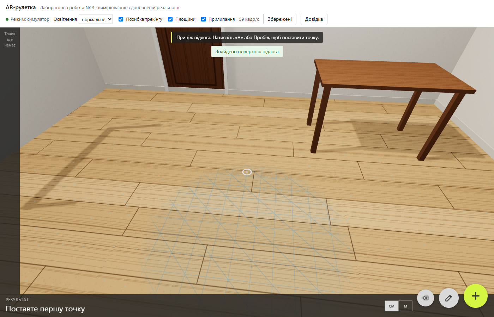
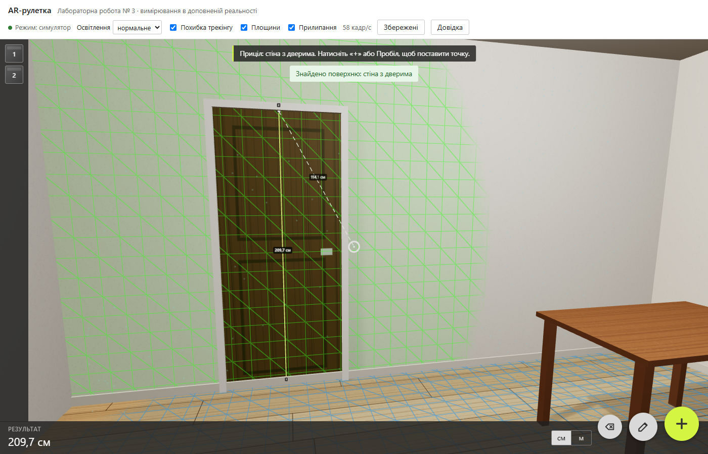
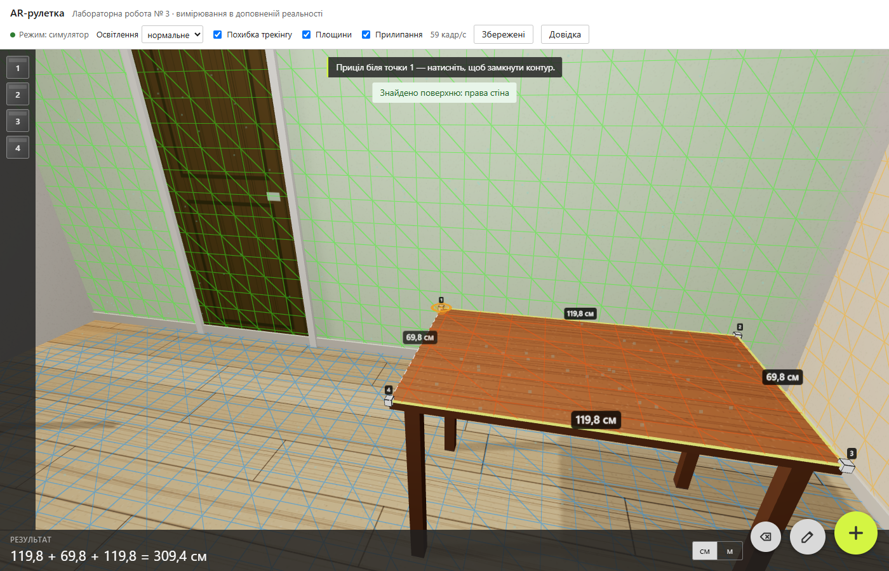
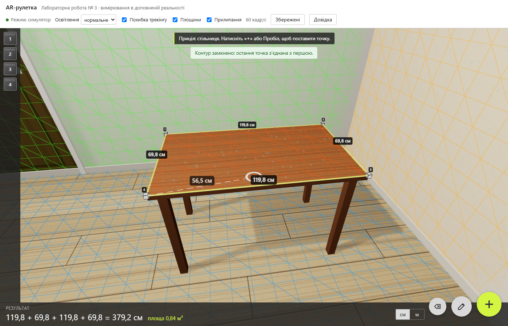
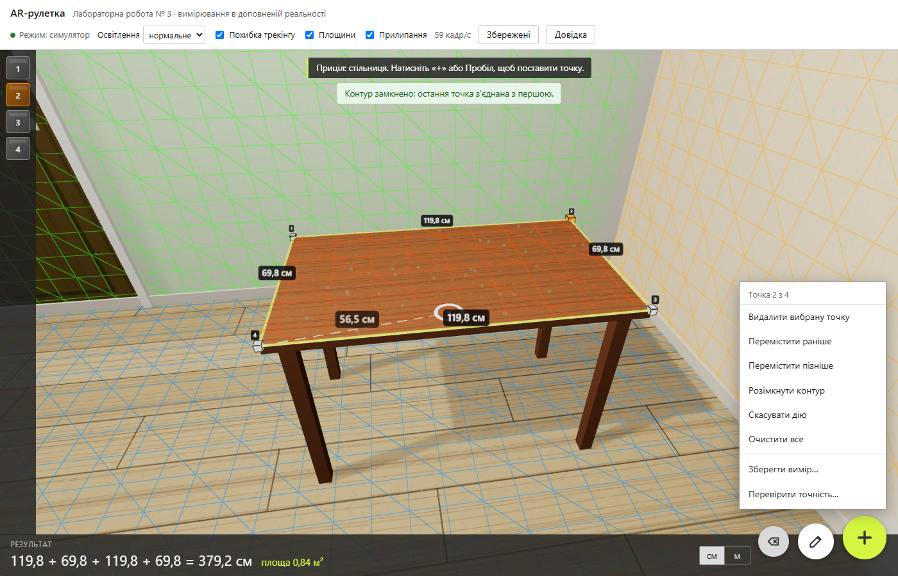
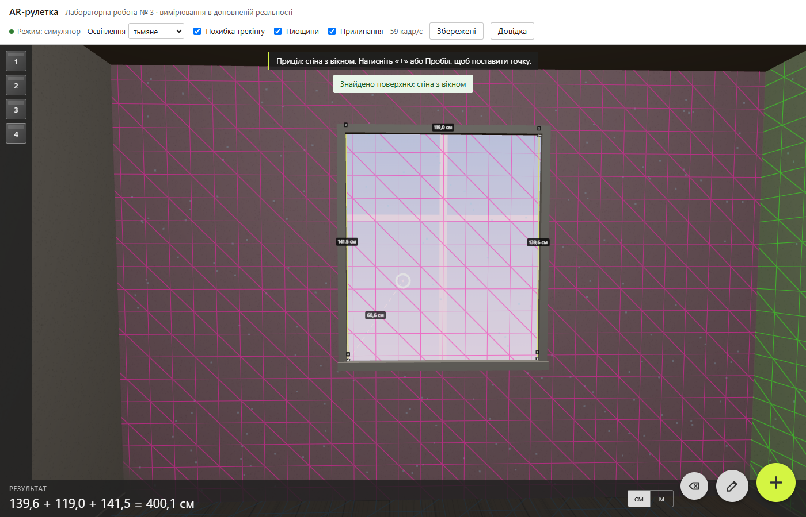
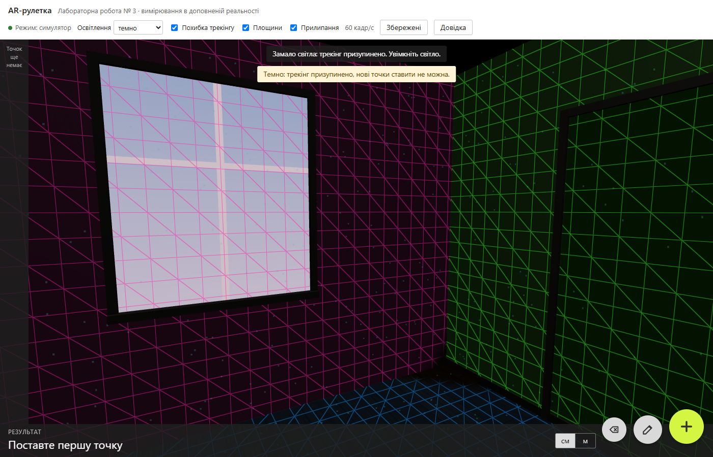
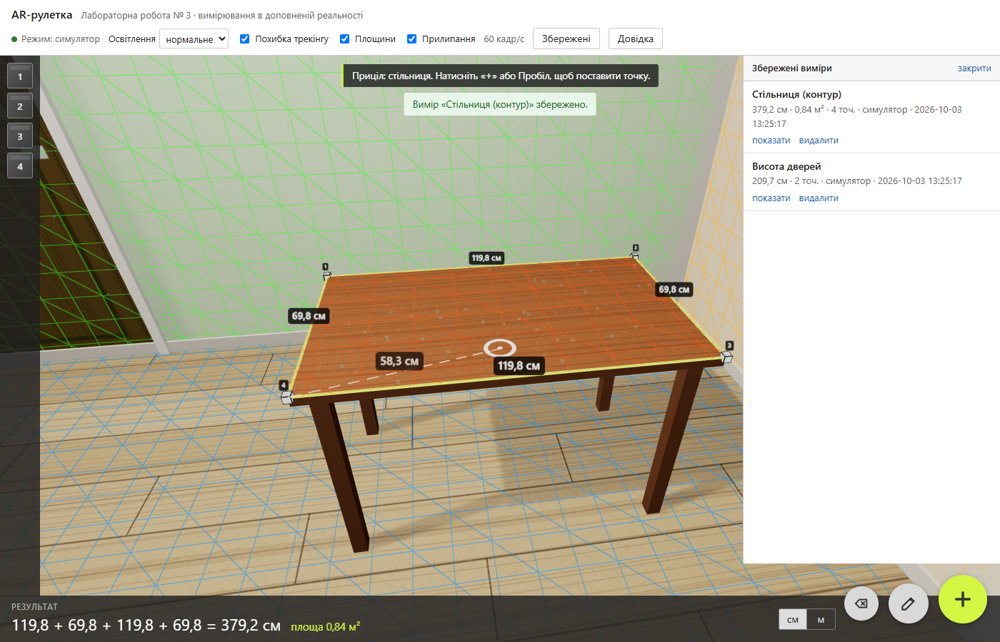
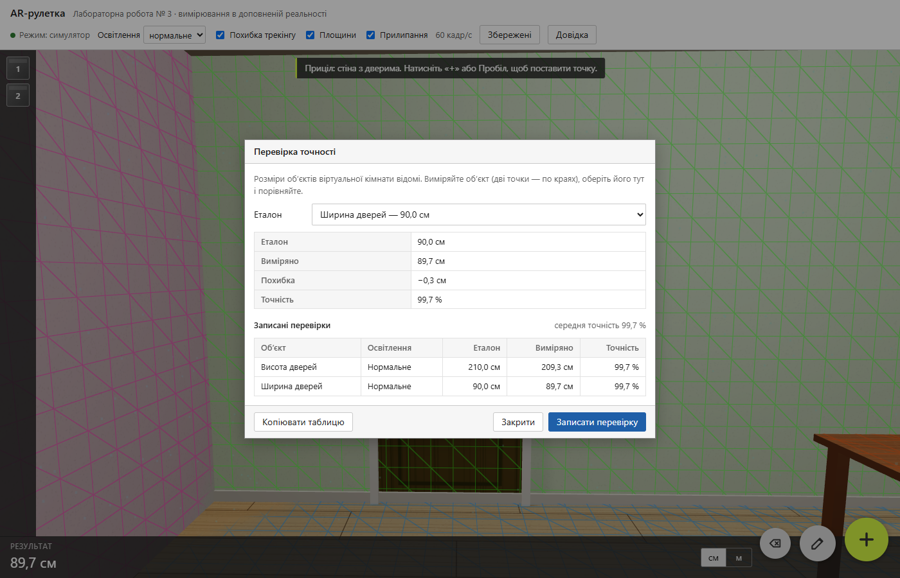
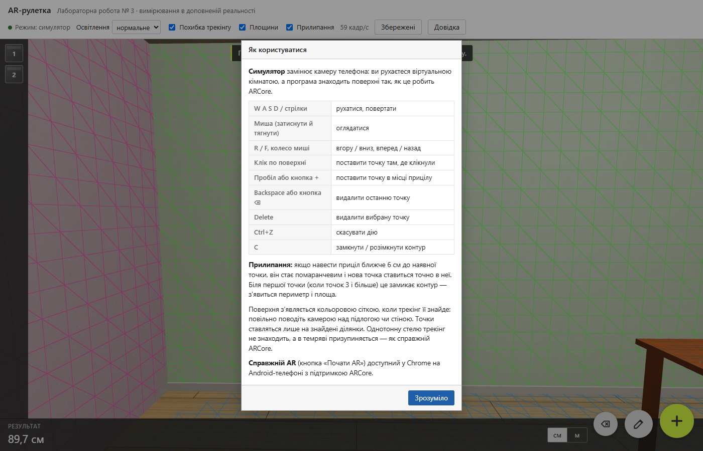

# Звіт з лабораторної роботи №3

**Тема:** Розробка інноваційного інтерфейсу доповненої реальності для взаємодії з віртуальним простором

| | |
|---|---|
| Дисципліна | ____________________ |
| Виконав(ла) | студент(ка) групи ______, ____________________ |
| Перевірив(ла) | ____________________ |
| Дата | ____________________ |

---

## 1. Мета роботи

Розробити застосунок з інтерфейсом доповненої реальності (AR), у якому користувач виконує корисну дію — вимірювання в реальному просторі — через взаємодію з віртуальними об’єктами, накладеними на зображення камери. Дослідити AR як сучасний інтерфейс, використовуючи безкоштовні технології (ARCore від Google).

## 2. Постановка завдання

За прикладом із завдання (Android-застосунок для вимірювань на ARCore) розроблено **AR-рулетку**: вебзастосунок, у якому користувач:

- знаходить поверхні (підлогу, стіни, стіл), які відображаються кольоровою сіткою;
- ставить віртуальні точки на поверхні дотиком (кліком) або в місці прицілу;
- бачить лінії між точками й довжини відрізків прямо в просторі, а знизу — підсумок: «113,0 + 77,8 + 126,5 = 317,3 см»;
- редагує вимір через віртуальне меню: видаляє точки, змінює їх порядок, замикає контур (периметр і площа), скасовує дії;
- зберігає виміри в базі даних і перевіряє точність за еталонами.

**Ключове рішення.** Справжнє розпізнавання поверхонь потребує телефона з ARCore, якого під час виконання роботи не було. Тому застосунок має два режими з однаковою логікою вимірювання:

| Режим | Призначення |
|---|---|
| **Симулятор AR** (основний) | Віртуальна кімната замість камери телефона. Відтворює поведінку ARCore: поступове знаходження площин, hit-test, похибку трекінгу, вплив освітлення. Працює на звичайному комп’ютері. |
| **Справжній AR** (WebXR) | Chrome на Android-телефоні з ARCore: камера, справжні площини, дотик до екрана ставить точку. Написаний за специфікацією WebXR, на пристрої не перевірявся. |

## 3. Вибір технологій та обґрунтування

| Компонент | Обрана технологія | Обґрунтування |
|---|---|---|
| Платформа | **Вебзастосунок** | Працює без встановлення на комп’ютері й телефоні; той самий стек, що в лабораторних 1–2 |
| AR на пристрої | **WebXR Device API** (`immersive-ar`, `hit-test`, `dom-overlay`, `plane-detection`) | Безкоштовний стандарт браузера. У Chrome на Android працює поверх **ARCore** і дає ті самі можливості, що нативний застосунок із прикладу (площини, hit-test), але без збирання APK. |
| 3D-графіка | **three.js** 0.186 | Найпоширеніша безкоштовна бібліотека WebGL з вбудованою підтримкою WebXR. Роздається з `node_modules`, без CDN. |
| Симулятор | Власний, на three.js | Дає змогу розробляти, тестувати й демонструвати без AR-пристрою. Відомі розміри кімнати дозволяють вимірювати точність. |
| Сервер, БД | Node.js + Express, SQLite (`node:sqlite`) | Як у попередніх роботах. Довжину й площу сервер перераховує сам, а не довіряє клієнту. |

**Порівняння з альтернативами:**

| Технологія | Чому не обрана |
|---|---|
| Нативний Android + ARCore (Java/Kotlin) | Потрібні Android Studio, збирання APK і телефон для будь-якої перевірки. Логіку вимірювання не можна протестувати на комп’ютері. |
| AR.js | Працює з паперовими маркерами, а не з довільними поверхнями: для вимірювань стін і підлоги не підходить |
| Unity + AR Foundation | Важке середовище; для веб-демонстрації та автоматичних тестів незручне |
| Google Cloud Vision API | Розпізнає вміст зображень, але не будує 3D-площин і не дає метричних координат |

## 4. Архітектура

```
Браузер                                                     Сервер (Node.js)
┌───────────────────────────────────────────────────┐      ┌──────────────────────────────┐
│ Симулятор (sim/)              Справжній AR (xr/)   │      │ GET    /api/measurements     │
│  кімната, камера, трекінг      WebXR + ARCore      │      │ GET    /api/measurements/:id │
│  hit-test з похибкою           hit-test, площини   │ REST │ POST   /api/measurements     │
│            └──────────┬───────────┘                │◄────►│ DELETE /api/measurements/:id │
│  Вимір (measurement.js) + геометрія (geometry.js)  │ JSON │   validation.js → db.js      │
│  3D-шар (layer.js): точки, лінії, підписи, приціл  │      │   (довжину й площу           │
│  Інтерфейс (app.js): меню, збереження, точність    │      │    рахує сервер)             │
└───────────────────────────────────────────────────┘      └──────────────────────────────┘
```

Логіка вимірювання — `geometry.js` і `measurement.js` — не залежить ні від three.js, ні від браузера. Її однаково використовують симулятор, справжній AR і сервер, і вона покрита модульними тестами.

### Структура проєкту

| Файл | Призначення | Рядків |
|---|---|---|
| `public/js/geometry.js` | відстані, ламана, площа (метод Ньюела), площинність, прилипання, формат | 106 |
| `public/js/measurement.js` | вимір: точки, порядок, замкненість, скасування | 109 |
| `public/js/layer.js` | 3D-відображення: точки, лінії, підписи, прев’ю, приціл | 176 |
| `public/js/sim/room.js` | віртуальна кімната, процедурні текстури, сітка площин (шейдер GLSL) | 308 |
| `public/js/sim/tracking.js` | модель трекінгу: швидкість знаходження, похибка, еталони | 60 |
| `public/js/sim/simulator.js` | камера, керування, трекінг, hit-test | 296 |
| `public/js/xr/webxr.js` | справжній AR через WebXR | 129 |
| `public/js/app.js` | інтерфейс: меню, прилипання, збереження, перевірка точності | 458 |
| `public/index.html`, `style.css` | розмітка й стилі | 340 |
| `server.js`, `src/` | REST API, SQLite, валідація | 129 |
| `test/` | модульні тести та браузерні перевірки | 429 |

### База даних

```sql
CREATE TABLE measurements (
  id         INTEGER PRIMARY KEY AUTOINCREMENT,
  name       TEXT    NOT NULL,
  points     TEXT    NOT NULL,           -- JSON: [{ x, y, z }] у метрах
  closed     INTEGER NOT NULL DEFAULT 0, -- замкнений контур
  total_m    REAL    NOT NULL,           -- сумарна довжина, м
  area_m2    REAL,                       -- площа замкненого плоского контуру, м²
  source     TEXT    NOT NULL,           -- 'sim' або 'webxr'
  created_at TEXT    NOT NULL DEFAULT (datetime('now', 'localtime'))
);
```

## 5. Хід роботи

### 5.1. Налаштування середовища

Встановлено Node.js 24, залежності `express` і `three`. three.js підключено через import map, а сервер роздає його з `node_modules`. WebXR вбудований у Chrome і окремого встановлення не потребує.

### 5.2. Віртуальна кімната

Кімната 5 × 4 × 2,7 м має двері 90 × 210 см, вікно 120 × 140 см і стіл 120 × 70 × 75 см. Текстури (паркет, штукатурка, дерево, вікно) малюються програмно на canvas, без зовнішніх файлів. Освітлення складається з напівсферичного, спрямованого (з тінями) й точкового світла. Режими «тьмяне» та «темно» зменшують його інтенсивність.

### 5.3. Як симулятор відтворює ARCore

| Поведінка ARCore | Реалізація в симуляторі |
|---|---|
| Площини знаходяться, поки камера їх оглядає | П’ять променів від камери (центр і чотири точки довкола) щокадру накопичують «впевненість» у поверхні. Швидкість залежить від освітлення, відстані (до 5 м) і кута огляду. При впевненості 1 поверхню знайдено. |
| Знайдена площина розростається | Сітка розширюється від місця знаходження в бік ділянок, які оглядає камера. Реалізовано шейдером: трикутна сітка, маскована радіусом. |
| «Характерні точки» трекінгу | На поверхні, яку ще шукають, з’являються блакитні точки |
| Hit-test тільки по знайдених ділянках | Промінь від прицілу (центр екрана) або від місця кліку перетинає реальну геометрію кімнати (з урахуванням перешкод, наприклад стола). Точка приймається, лише якщо ділянка вже знайдена. |
| Однотонні поверхні не розпізнаються | Стеля позначена як поверхня без деталей |
| У темряві трекінг зупиняється | При «темно» поверхні не знаходяться, а hit-test повертає «Замало світла» |
| Похибка вимірювань | До точки додається похибка вздовж площини (нормальний розподіл, генератор Бокса — Мюллера). σ = 2 мм × (1 + d/2) при нормальному світлі й 6 мм × (1 + d/2) при тьмяному, де d — відстань до поверхні. |

Час знаходження підлоги, виміряний автотестом: **0,7 с** при нормальному світлі, **1,9 с** при тьмяному. У темряві поверхня не знаходиться.

### 5.4. Вимірювання

- **Відстань** між точками — евклідова в 3D. Ламана — сума відрізків. Замкнений контур додає відрізок «остання точка → перша».
- **Площа** замкненого контуру рахується методом Ньюела: половина модуля суми векторних добутків. Він працює для контуру в будь-якій площині (підлога, стіна, похила поверхня) і для неопуклих багатокутників. Площа рахується, лише якщо всі точки лежать в одній площині з допуском 2 см; інакше застосунок пише «контур не плоский».
- **Прилипання.** Якщо приціл ближче 6 см до наявної точки, нова точка ставиться точно в неї:
  - біля **першої** точки (коли точок 3 і більше) контур замикається;
  - біля **проміжної** — лінії сходяться без зазору;
  - біля **останньої** — дублювання не допускається.
- **Валідація:** координати мають бути скінченними й у межах ±100 м, точки ближче 5 мм до попередньої не приймаються (подвійний дотик), в одному вимірі до 50 точок.

### 5.5. Інтерфейс

Інтерфейс повторює мобільні AR-рулетки на зразок прикладу із завдання:
- смуга точок ліворуч;
- рядок «РЕЗУЛЬТАТ» знизу;
- круглі кнопки «+» (додати точку), «олівець» (меню) і «⌫» (видалити останню).

Від останньої точки до прицілу тягнеться пунктир із поточною відстанню. Підказка вгорі пояснює, що робити далі. У режимі WebXR той самий блок інтерфейсу показується поверх камери (`dom-overlay`).

Пошук поверхонь — щойно почали оглядати підлогу (блакитні характерні точки, сітка з’являється):



Вимірювання висоти дверей (еталон 210 см) і пунктир від останньої точки до прицілу:



Прилипання: приціл біля першої точки став помаранчевим, підказка пропонує замкнути контур:



Замкнений контур стільниці — периметр і площа:



Меню редагування для вибраної точки:



Вимірювання вікна при тьмяному освітленні (похибка трохи більша):



Темрява — трекінг призупинено, нові точки не ставляться:



Збережені виміри з бази даних:



Перевірка точності за еталоном:



Довідка з керуванням:



## 6. Безпека

| Загроза | Захист |
|---|---|
| Підробка результату | Сервер не приймає довжину й площу від клієнта, а перераховує їх із координат |
| Некоректні дані | Валідація на сервері: назва 1–60 символів, 2–50 точок, скінченні координати в межах ±100 м, допустиме джерело (`sim`/`webxr`) |
| SQL-ін’єкції | Параметризовані запити |
| XSS | Дані виводяться в сторінку лише через `textContent` |
| Перевантаження | Тіло запиту до 32 КБ, зрозумілі відповіді на некоректний JSON |
| Конфіденційність | Камера (у режимі AR) обробляється на пристрої, зображення на сервер не надсилаються. Хмарних ключів API немає. |

## 7. Тестування

### 7.1. Модульні тести (`npm test`) — 15 тестів, усі пройдено

- геометрія: відстані, ламана, площа на підлозі, на похилій стіні й для неопуклого (Г-подібного) контуру, неплоский контур, формат («113,0 + 77,8 + 126,5 = 317,3 см»), точність відносно еталона, валідація координат, прилипання;
- вимір: додавання, подвійний дотик, видалення, зміна порядку, замикання, скасування, завантаження, ліміт точок;
- модель трекінгу: залежність від світла, відстані й кута; відтворюваний генератор похибки з нормальним розподілом (перевірено на 20 000 вибірках);
- REST API: збереження, читання, видалення, валідація, серверний перерахунок довжини й площі.

### 7.2. Браузерні перевірки (`npm run test:e2e`) — 23 перевірки, усі пройдено

Chrome без вікна й без звуку керує симулятором через протокол DevTools.

| Що перевіряється | Результат |
|---|---|
| Без знайденої поверхні точка не ставиться | ✔ підказка «Поверхню ще не знайдено» |
| Поверхня знаходиться не миттєво | ✔ через 0,5 с — ні, через 2,5 с — так |
| Висота дверей (еталон 210 см) | ✔ 209,7 см |
| Точність із похибкою трекінгу, 10 вимірів | ✔ > 99 % (нормальне й тьмяне світло) |
| Контур стільниці: периметр і площа | ✔ 379,2 см і 0,84 м² (еталон 380 см і 0,84 м²) |
| Стеля не розпізнається; темрява зупиняє трекінг | ✔ / ✔ |
| Клік мишею ставить точку там, де клікнули | ✔ |
| Меню: порядок, видалення, скасування; одиниці см/м | ✔ |
| Збереження в базу й відкриття збереженого | ✔ |
| Діалог перевірки точності | ✔ 99,9 % |
| Прилипання: біля першої (замикає контур), проміжної, останньої точки; вимкнене прилипання | ✔ ✔ ✔ ✔ |
| Видалення останньої точки клавішею Backspace і кнопкою | ✔ |
| Після очищення прев’ю-лінія зникає | ✔ |
| Помилки в консолі | ✔ немає |

### 7.3. Точність вимірювань (вимога завдання — понад 90 %)

Кожен еталонний об’єкт кімнати виміряно автоматично **10 разів** за кожних умов освітлення, з увімкненою похибкою трекінгу (дві точки по краях об’єкта).

| Об’єкт | Еталон | Нормальне світло: середня точність | Похибка, см | Тьмяне світло: середня точність | Похибка, см |
|---|---|---|---|---|---|
| Висота дверей | 210 см | 99,73 % | 0,56 | 99,44 % | 1,18 |
| Ширина дверей | 90 см | 99,43 % | 0,51 | 98,45 % | 1,39 |
| Висота вікна | 140 см | 99,78 % | 0,30 | 99,18 % | 1,15 |
| Ширина вікна | 120 см | 99,58 % | 0,50 | 99,27 % | 0,88 |
| Довжина стільниці | 120 см | 99,59 % | 0,50 | 99,00 % | 1,20 |
| Ширина стільниці | 70 см | 99,54 % | 0,32 | 98,35 % | 1,15 |
| Висота стіни | 270 см | 99,87 % | 0,34 | 99,43 % | 1,55 |
| **Разом (140 вимірів)** | | **99,65 %** | **0,43** | **99,02 %** | **1,21** |

Найгірший окремий вимір — 95,4 % (стільниця при тьмяному світлі). Вимогу понад 90 % виконано для всіх 140 вимірів. При тьмяному освітленні похибка приблизно втричі більша, а в темряві вимірювання неможливе. Це відповідає поведінці реального ARCore, описаній у завданні: «AR погано працює в темряві».

Під час збору статистики виявилось, що вимір висоти стіни в одному місці дав похибку 30 см. Причина виявилася в стільниці: вона стояла між камерою та низом стіни, і промінь влучав у неї. Застосунок поводився правильно, як і справжній AR, бо видима поверхня закриває ту, що за нею. Вимір перенесено туди, де стіну видно повністю.

### 7.4. Ручні вимірювання автора

> Таблицю заповнює автор роботи вручну, керуючи симулятором мишею й клавіатурою. Меню → «Перевірити точність…» → «Записати перевірку» → «Копіювати таблицю».

| Об’єкт | Освітлення | Еталон | Виміряно | Точність |
|---|---|---|---|---|
| ___ | ___ | ___ | ___ | ___ % |
| ___ | ___ | ___ | ___ | ___ % |
| ___ | ___ | ___ | ___ | ___ % |

### 7.5. Тестування за відгуками та виправлення

| Відгук або знахідка | Рішення |
|---|---|
| Точки, поставлені поруч, мають «прилипати» одна до одної | Прилипання в радіусі 6 см; біля першої точки контур замикається автоматично; перемикач «Прилипання» |
| Потрібна швидка кнопка «видалити останню точку» на клавіатурі | Кнопка ⌫ і клавіша Backspace (Delete — вибрана точка, Ctrl+Z — скасування) |
| Після очищення виміру лишався «завислий» пунктир із підписом | Прев’ю примусово перемальовується після кожної зміни виміру; додано автоперевірку |
| Панель збережених вимірів перекривала кнопку «+» | Панель укорочено |

### 7.6. Продуктивність

- У браузері без відеокарти (програмний GPU) симулятор працює зі швидкістю **54–60 кадр/с**, що перевищує ціль завдання (30 кадр/с).
- Підписи відстаней і прев’ю перемальовуються лише тоді, коли змінюються дані, а не щокадру.
- three.js завантажується локально; уся робота відбувається на клієнті, сервер лише зберігає виміри.

## 8. Розгортання

```bash
npm install
npm start          # http://localhost:3002
npm test           # модульні тести
npm run test:e2e   # браузерні перевірки
```

Для справжнього AR телефон підключається через USB: `adb reverse tcp:3002 tcp:3002`, після чого в Chrome на телефоні відкривається `http://localhost:3002` (WebXR вимагає HTTPS або `localhost`). Для публічного розгортання потрібен HTTPS-хостинг (Render, Railway тощо).

## 9. Висновки

1. Розроблено AR-рулетку: вебзастосунок, у якому користувач ставить віртуальні точки на поверхні й отримує відстані, периметри й площі прямо в просторі. Є редагування через віртуальне меню, прилипання точок, збереження в базу й перевірка точності.
2. Для справжньої доповненої реальності використано безкоштовний стандарт WebXR, який у Chrome на Android працює поверх ARCore. Це дає можливості нативного ARCore-застосунку без встановлення APK.
3. Через відсутність AR-пристрою розроблено симулятор, що відтворює ключову поведінку ARCore: поступове знаходження площин, hit-test лише по знайдених ділянках, похибку трекінгу, залежність від освітлення. Він дав змогу розробляти, автоматично тестувати й демонструвати застосунок на звичайному комп’ютері.
4. Точність вимірювань у симуляторі — **99,65 %** при нормальному і **99,02 %** при тьмяному освітленні (140 автоматичних вимірів), що значно перевищує вимогу 90 %. У темряві трекінг зупиняється, як і в реальному ARCore.
5. Якість підтверджено 15 модульними тестами й 23 браузерними перевірками. Режим WebXR написано за специфікацією, але на реальному телефоні його не перевіряли. Це наступний крок для подальшої роботи.
