# Звіт з лабораторної роботи №4

**Тема:** Розробка інноваційного інтерфейсу віртуального меню в доповненій або віртуальній реальності з використанням AR/VR-окулярів

| | |
|---|---|
| Дисципліна | ____________________ |
| Виконав(ла) | студент(ка) групи ______, ____________________ |
| Перевірив(ла) | ____________________ |
| Дата | ____________________ |

---

## 1. Мета роботи

Розробити застосунок із віртуальним 3D-меню в імерсивному просторі, де користувач обирає опції, переходить між розділами й виконує дії без миші та клавіатури: поглядом, жестами рук або голосом. Дослідити принципи інтерфейсів для AR/VR-окулярів: «плаваючі» панелі, вибір поглядом із затримкою, промінь контролера, захист від випадкових виборів («проблема Мідаса»), точність і затримку взаємодії.

## 2. Постановка завдання

За першим прикладом із завдання розроблено **VR-меню ресторану «Віртуальний смак»**. Користувач опиняється у віртуальному ресторані, і перед ним з’являється 3D-меню:

- **головна сторінка:** 6 категорій, замовлення, налаштування;
- **категорія:** картки страв із 3D-мініатюрами, ціною й калорійністю, гортання сторінок;
- **страва:** опис, ціна, вага, кількість і кнопка «Додати». Поруч на поворотній підставці — 3D-модель страви, а довкола неї «плавають» інгредієнти (вимога прикладу: «вибір страви активує віртуальний перегляд інгредієнтів»);
- **замовлення і підтвердження:** оформлене замовлення зберігається в базі даних;
- **налаштування:** відстань меню, яскравість сцени, час вибору поглядом, вмикання вибору поглядом і слідування меню за поглядом.

Керувати меню можна п’ятьма способами: **погляд** (затримка ~1 с), **промінь контролера**, **жести руки** (щипок — вибір, мах — гортання), **голос** і **справжній погляд очима через вебкамеру** (з калібруванням).

**Ключове рішення.** Завдання вимагає AR/VR-окулярів, але дозволяє «десктопний [застосунок] з емуляцією». Окулярів під час виконання роботи не було, тому застосунок має два режими з однаковою логікою меню та взаємодії:

| Режим | Призначення |
|---|---|
| **Емуляція окулярів** (основний) | Звичайний браузер на комп’ютері. «Голова» — камера сцени (огляд мишею, W A S D), погляд — приціл у центрі поля зору або оцінка очей із вебкамери, промінь контролера — від миші, рука — з вебкамери (MediaPipe). |
| **Справжні окуляри** (WebXR) | Браузер Meta Quest (або інших окулярів із WebXR): кнопки «Увійти у VR» та «Увійти в AR» (прохідна камера). Працюють контролери (курок — вибір, бокова кнопка — показати / сховати меню), руки (щипок) і погляд. Написано за специфікацією WebXR, на реальних окулярах не перевірялося. |

## 3. Вибір технологій та обґрунтування

| Компонент | Обрана технологія | Обґрунтування |
|---|---|---|
| AR/VR-платформа | **WebXR Device API** (`immersive-vr`, `immersive-ar`, `local-floor`, `hand-tracking`, `dom-overlay`) | Безкоштовний відкритий стандарт W3C. Той самий застосунок відкривається в браузері Meta Quest, Pico, HoloLens 2 (Edge) і на комп’ютері. Не потрібні збирання APK, магазин застосунків і окуляри для кожної перевірки. Підтримку WebXR названо в завданні як варіант. |
| 3D-графіка | **three.js** 0.186 | Найпоширеніша безкоштовна бібліотека WebGL з вбудованим WebXRManager (контролери, руки, сесії). Роздається локально з `node_modules`. |
| 3D-інтерфейс | Власні панелі й кнопки: текст малюється на canvas і стає текстурою | Будь-які шрифти й українська мова; стани наведення, натиснення й прогресу погляду. Аналог Canvas у Unity / Widgets в Unreal із завдання. |
| Жести руки (без окулярів) | **MediaPipe Gesture Recognizer** (з лаб. 2) | Працює локально в браузері, безкоштовно, без хмари. Названий у завданні. |
| Погляд очима (без окулярів) | **MediaPipe Face Landmarker** | 478 точок обличчя разом із центрами зіниць і матрицею повороту голови, локально, ~4 МБ. Замінює айтрекер окулярів (Eye Tracking API із завдання), якого на комп’ютері немає. |
| Голос | **Web Speech API** (з лаб. 1) | Вбудований у Chrome / Edge, безкоштовний, українська мова |
| Сервер, БД | Node.js 24 + Express, SQLite (`node:sqlite`) | Як у попередніх роботах. Меню зберігається в базі, суму замовлення рахує сервер. |

**Порівняння з альтернативами:**

| Технологія | Чому не обрана |
|---|---|
| Unity + Oculus Integration / XR Interaction Toolkit (C#) | Важке середовище (кілька ГБ), збирання APK під кожну гарнітуру, без окулярів неможливо перевірити навіть базову взаємодію; автоматичні браузерні тести неможливі |
| Unreal Engine + VisionOS SDK (C++) | Потрібні Mac і Apple Vision Pro; найважче середовище |
| Microsoft Mixed Reality Toolkit | Орієнтований на HoloLens, якого немає |
| TensorFlow.js (власна модель жестів) | Для щипка й маху достатньо правил над точками руки MediaPipe; навчати власну модель не потрібно |

## 4. Архітектура

```
Браузер                                                                Сервер (Node.js)
┌──────────────────────────────────────────────────────────────┐     ┌──────────────────────┐
│ Входи:  погляд (голова / очі з вебкамери)   миша = промінь    │     │ GET  /api/menu       │
│         рука з вебкамери (MediaPipe)        голос (Web Speech)│     │ GET  /api/orders     │
│         контролери й руки окулярів (WebXR)                    │ REST│ POST /api/orders     │
│                         │                                     │◄───►│                      │
│ InteractionManager: промені → наведення → затримка погляду   │ JSON│ validation.js        │
│                         │ (дія + спосіб)                      │     │  (ціни й суму рахує  │
│ app.js: act(дія) → MenuModel (стан) → MenuView (3D-сторінки) │     │   сервер)            │
│ Сцена three.js: ресторан, меню, 3D-страви; WebXR-сесія       │     │ db.js → SQLite       │
└──────────────────────────────────────────────────────────────┘     └──────────────────────┘
```

Усі способи взаємодії зводяться до однієї функції `act(дія, параметр, спосіб)`. Тому кожну дію меню можна виконати будь-яким способом, а в базу записується, яким саме способом підтверджено замовлення. Модель меню (`menu-model.js`), логіка затримки (`dwell.js`), розбір голосу, жести руки, ознаки очей і калібрування — чисті модулі без three.js і браузера, покриті модульними тестами.

### Структура проєкту

| Файл | Призначення | Рядків |
|---|---|---|
| `public/js/menu-model.js` | стан меню: сторінки, навігація, кількість, кошик, підтвердження, налаштування | 228 |
| `public/js/menu-view.js` | 3D-сторінки меню, модель страви з інгредієнтами, слідування за поглядом | 283 |
| `public/js/ui3d.js` | 3D-панелі й кнопки (текст на canvas), стани наведення й прогресу | 198 |
| `public/js/dishes3d.js` | процедурні 3D-моделі страв (піца, бургер, салат, суп, десерт, напій) | 143 |
| `public/js/environment.js` | віртуальний ресторан, освітлення | 111 |
| `public/js/interaction.js` | вказівники, промені, наведення, затримка погляду, захист від випадкового вибору, час обробки | 143 |
| `public/js/dwell.js` | вибір поглядом із затримкою | 35 |
| `public/js/desktop.js` | емуляція окулярів: голова, промінь від миші, приціл погляду | 154 |
| `public/js/xr.js` | WebXR: VR / AR сесії, контролери, руки | 71 |
| `public/js/hand-input.js`, `hand-gestures.js` | рука з вебкамери: курсор, щипок, мах | 132 |
| `public/js/eye-features.js` | ознаки погляду з точок обличчя | 61 |
| `public/js/gaze-calibration.js` | калібрувальна регресія, похибка, фільтри | 144 |
| `public/js/eye-tracker.js` | вебкамера + Face Landmarker → точка погляду | 139 |
| `public/js/eye-calibration.js` | екран калібрування (13 точок, результат) | 236 |
| `public/js/voice-input.js`, `voice-commands.js` | розпізнавання мовлення й розбір команд | 121 |
| `public/js/accuracy.js` | режим перевірки точності | 137 |
| `public/js/app.js` | зв’язування: дії меню, способи взаємодії, WebXR, цикл кадру | 472 |
| `public/index.html`, `style.css` | розмітка й стилі | 239 |
| `server.js`, `src/` | REST API, SQLite, дані меню, валідація | 167 |
| `test/` | модульні тести й браузерні перевірки | 760 |

### База даних

```sql
CREATE TABLE dishes (
  id          INTEGER PRIMARY KEY AUTOINCREMENT,
  category    TEXT    NOT NULL,
  name        TEXT    NOT NULL,
  description TEXT    NOT NULL,
  price       INTEGER NOT NULL,  -- грн
  kcal        INTEGER NOT NULL,
  weight      INTEGER NOT NULL,  -- г
  model       TEXT    NOT NULL,  -- тип 3D-моделі
  colors      TEXT    NOT NULL,  -- JSON: кольори моделі
  ingredients TEXT    NOT NULL   -- JSON: інгредієнти
);
CREATE TABLE orders (
  id         INTEGER PRIMARY KEY AUTOINCREMENT,
  items      TEXT    NOT NULL,   -- JSON: [{ dishId, name, price, qty }]
  total      INTEGER NOT NULL,   -- грн, рахує сервер
  method     TEXT    NOT NULL,   -- як підтверджено: gaze, eyes, mouse, controller, hand, voice
  created_at TEXT    NOT NULL DEFAULT (datetime('now', 'localtime'))
);
```

## 5. Хід роботи

### 5.1. Налаштування середовища

Встановлено Node.js 24 і залежності `express`, `three`, `@mediapipe/tasks-vision`. Під час `npm install` скрипт завантажує дві моделі MediaPipe: жести (~8 МБ) і обличчя з зіницями (~4 МБ). Далі застосунок працює без інтернету. three.js підключено через import map. WebXR і Web Speech API вбудовані в Chrome.

### 5.2. Віртуальне 3D-меню

- **Плаваючі панелі.** Меню — набір 3D-панелей і кнопок у просторі сцени. Текст малюється на canvas і накладається як текстура, тож кнопки мають стани «наведено» (підсвічування й висування вперед на 8 мм), «прогрес погляду» (смужка внизу) і «вимкнено».
- **Розміщення.** Меню з’являється на відстані 1 м (налаштовується 0,6–1,6 м) і трохи нижче рівня очей (на 0,3 м, ~17°): так зручно для шиї, а погляд «прямо» не потрапляє на кнопки випадково. Картки страв стоять дугою й повернуті до користувача.
- **Слідування за поглядом.** Якщо відвернутися від меню більш ніж на 35°, воно плавно (згладжування за експонентою) переїжджає перед погляд. Цю функцію можна вимкнути.
- **3D-страви.** Шість процедурних моделей (піца, бургер, салат, суп, десерт, напій) з кольорами конкретної страви. На сторінці страви модель обертається на підставці, а підписи інгредієнтів розміщено дугою над нею (160° → 20°), щоб вони не перекривалися.
- **Віртуальний ресторан:** стіни, підлога, столи, рослини, лампи; яскравість сцени регулюється в налаштуваннях. В AR-режимі ресторан ховається, і меню «плаває» поверх реального світу.

### 5.3. Емуляція окулярів і WebXR

| Окуляри | Емуляція на комп’ютері |
|---|---|
| Поворот голови (гіроскоп) | Затиснути ліву кнопку миші й тягнути, або стрілки / Q / E |
| Переміщення | W A S D |
| Погляд (центр поля зору) | Приціл у центрі екрана |
| Айтрекінг очей | Вебкамера + калібрування (розділ 5.5) |
| Промінь контролера, курок | Промінь від «руки» до курсора миші, клік |
| Руки (hand-tracking) | Рука з вебкамери, щипок |

У WebXR-сесії (`immersive-vr` або `immersive-ar` з `local-floor`) three.js отримує положення голови й контролерів від окулярів. Для кожного контролера будується промінь: курок (`selectstart`) — вибір, бокова кнопка (`squeezestart`) — показати / сховати меню. Руки окулярів (`hand-tracking`) обирають щипком. В AR через `dom-overlay` поверх камери показується рядок стану.

### 5.4. Способи взаємодії та обробка

`InteractionManager` щокадру кидає промені від усіх активних вказівників (погляд, миша, рука, контролери) у кнопки меню (raycasting) і визначає, що під кожним вказівником.

| Спосіб | Як обирається | Правило |
|---|---|---|
| Погляд | затримка на кнопці | **погляд на пункті ≥ 1 с = вибір** (базове правило із завдання), прогрес видно смужкою на кнопці й кільцем прицілу; час налаштовується 0,5–3 с |
| Промінь (миша / контролер) | клік / курок | вибір того, що під променем саме в момент натискання (промінь перераховується, а не береться з минулого кадру) |
| Рука з вебкамери | щипок | курсор — центр долоні; щипок (великий + вказівний, жест «OK») — вибір; мах долонею вбік — гортання сторінок |
| Голос | команда | «меню», «закрити», «піца», «маргарита», «далі», «назад», «головна», «плюс», «мінус», «додай в замовлення», «замовлення», «оформити», «так» / «ні», «налаштування», номери цілей |
| Очі з вебкамери | затримка | як погляд, але напрям — з калібрувальної моделі очей (розділ 5.5) |

**Захист від випадкових виборів («проблема Мідаса»)** — головний ризик інтерфейсів, керованих поглядом:

- вибір поглядом відбувається лише після затримки, а не миттєво;
- **після появи нової сторінки кнопка, на якій уже стоїть погляд, не спрацьовує**, доки погляд із неї не зійде: вибір має бути свідомим наведенням. Виняток — ціль, яку система щойно сама запропонувала обрати (у режимі перевірки точності);
- меню висить нижче рівня очей;
- оформлення замовлення — тільки через окрему сторінку підтвердження («Так» / «Ні»);
- вибір поглядом можна вимкнути, і тоді погляд нічого не підсвічує й не обирає.

### 5.5. Відстеження очей звичайною вебкамерою

Окуляри з айтрекером (Quest Pro, Vision Pro) знають, куди дивляться очі. На комп’ютері цю роль виконує вебкамера.

1. **Точки обличчя.** MediaPipe Face Landmarker у режимі відео знаходить 478 точок обличчя, серед них центри зіниць (точки 468 і 473), куточки очей (33, 133, 362, 263), повіки (159, 145, 386, 374), а також матрицю повороту голови.
2. **Ознаки.** Для кожного ока, де P₁, P₂ — куточки, I — центр зіниці, T, B — верхня й нижня повіки:
   - горизонталь `h = ((I − P₁) · (P₂ − P₁)) / |P₂ − P₁|²`;
   - вертикаль `v = (I_y − (T_y + B_y) / 2) / |P₂ − P₁|`;
   - розкриття ока `open = |B_y − T_y| / |P₂ − P₁|` (верхня повіка піднімається, коли дивимося вгору, — це підсилює слабку вертикальну ознаку);
   - значення двох очей усереднюються, додаються кути повороту голови (yaw, pitch); кадри з закритими очима (`open < 0,12`) пропускаються.
3. **Калібрування.** На екрані по черзі з’являються 9 точок (сітка 3 × 3). На кожній 1 с дається на те, щоб погляд «долетів», потім 1,5 с збирають ознаки (точка стискається, згори лічильник «Точка 3 з 13»). Перша чверть кадрів і кадри-викиди (далі ніж 2,5 робастних σ від медіани — кліпання, погляд убік) відкидаються.
4. **Модель** — гребенева регресія окремо для X і Y: ознаки стандартизуються й доповнюються квадратичними членами `h², v², h·v`, ваги `w = (XᵀX + λnI)⁻¹ Xᵀy`. Масштаб кожної ознаки обмежено знизу: якщо голова під час калібрування нерухома, без цього навіть невеликий поворот голови потім давав би стрибки прицілу.
5. **Оцінка похибки.** Ще 4 контрольні точки, яких модель не бачила. Система показує середню й найбільшу похибку в пікселях і градусах (за відстані 60 см) і малює, куди, на її думку, дивився користувач. Після цього модель донавчається на всіх 13 точках. На екрані результату видно живий приціл, щоб одразу перевірити, чи він встигає за очима.
6. **Згладжування.** Спочатку медіана кількох останніх оцінок (повністю прибирає поодинокі викиди), потім фільтр One Euro (сильно гасить повільне тремтіння, але майже не запізнюється на швидких рухах очей). Плавність обирається: слабка, середня або сильна.
7. **Вибір.** Точка погляду перетворюється на промінь від камери сцени. Ціллю вважається кнопка, на якій погляд був **найдовше за останні 300 мс**, тож короткі «вискоки» оцінки на сусідню кнопку не скидають відлік. Якщо обличчя зникло з кадру, погляд нічого не обирає.

Екран калібрування перед початком (обличчя знайдено, вибір плавності прицілу):

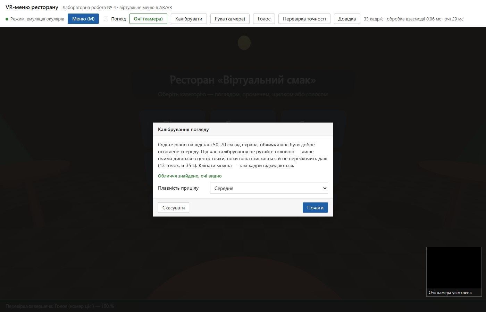

Калібрування: точка 4 з 13 стискається, поки збираються ознаки:

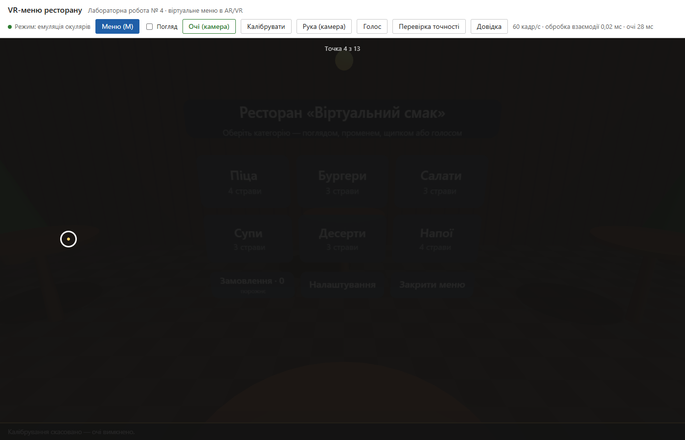

Результат: кола — контрольні точки, хрестики — оцінка системи, жовта точка — живий приціл:

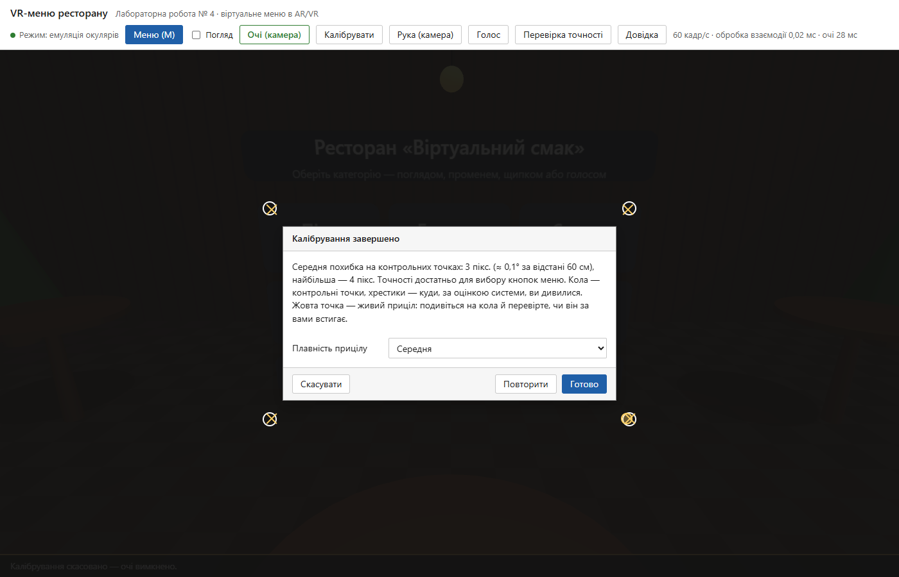

Вибір очима: приціл там, куди дивиться користувач, смужка на кнопці «Салати» показує відлік затримки:

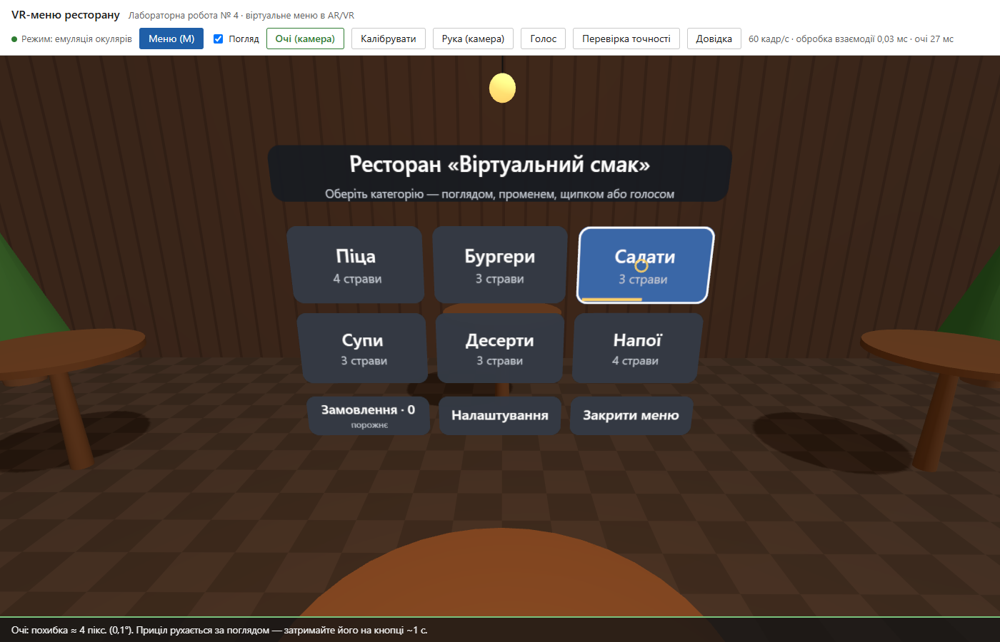

### 5.6. Замовлення

Кошик зберігається в моделі меню. Кількість однієї страви — від 1 до 20. «Оформити» відкриває сторінку підтвердження, а «Так» надсилає на сервер лише ідентифікатори страв, кількість і спосіб підтвердження. Ціни й суму сервер бере з бази.

### 5.7. Інтерфейс

Головна сторінка меню у віртуальному ресторані:

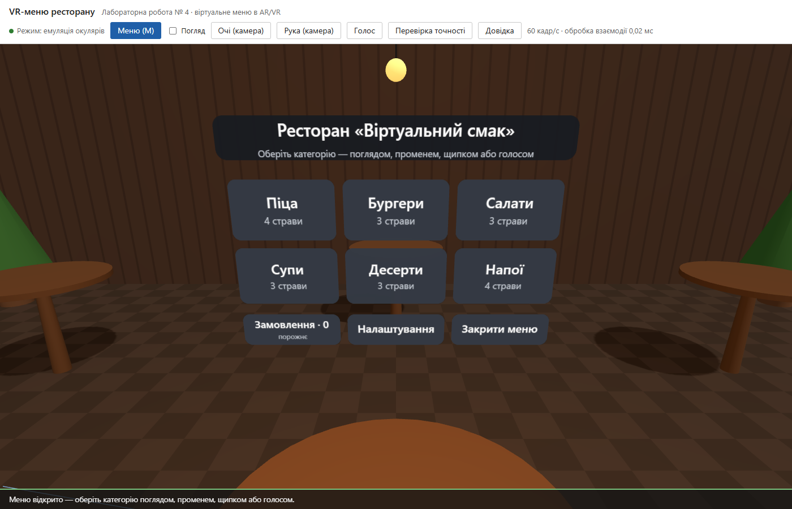

Вибір поглядом: приціл на кнопці «Піца», смужка й кільце показують прогрес затримки:

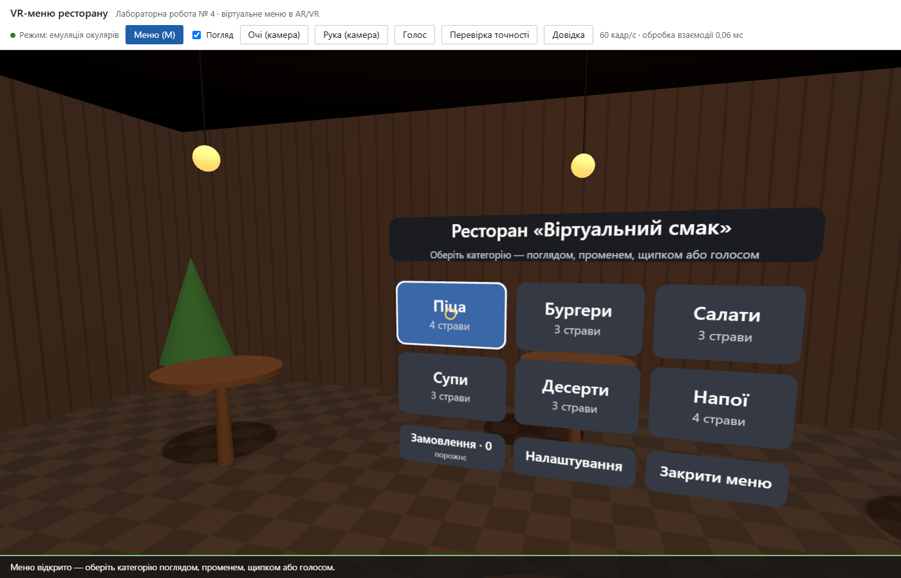

Категорія «Піца»: картки з 3D-мініатюрами, наведення променем від «руки» (миша):

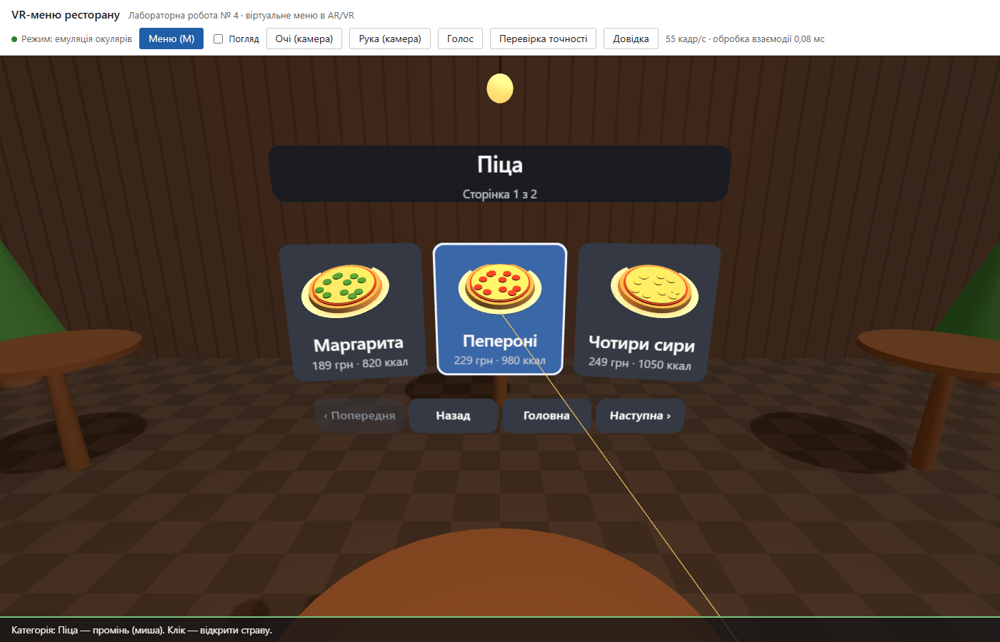

Сторінка страви: 3D-модель на поворотній підставці, інгредієнти «плавають» довкола:

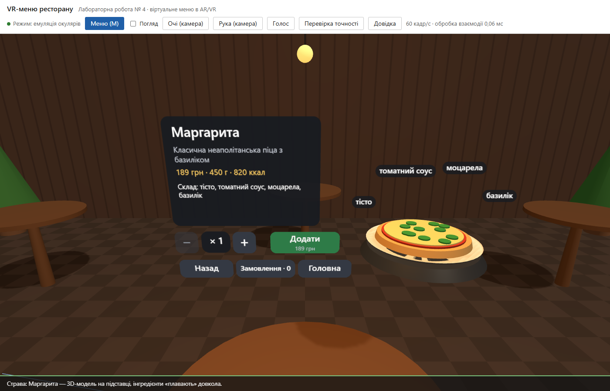

Рука з вебкамери: курсор долоні над кнопкою «+»:

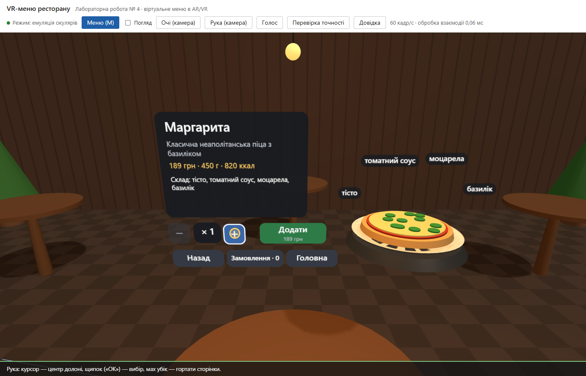

Замовлення, зібране голосом:

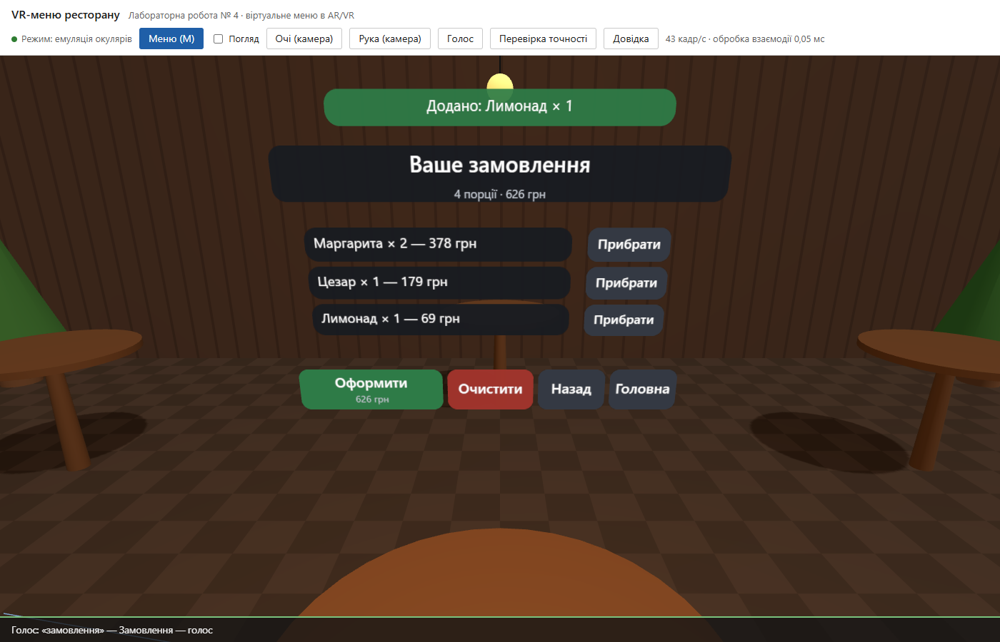

Підтвердження замовлення («Так» / «Ні», або голосом):

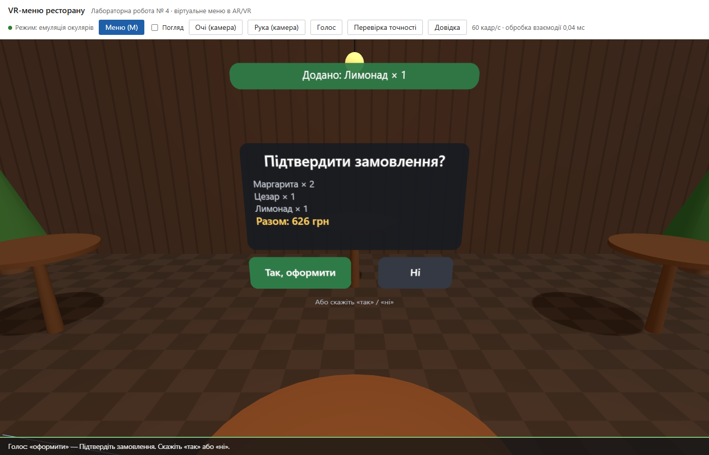

Налаштування (зверху — повідомлення про прийняте замовлення):

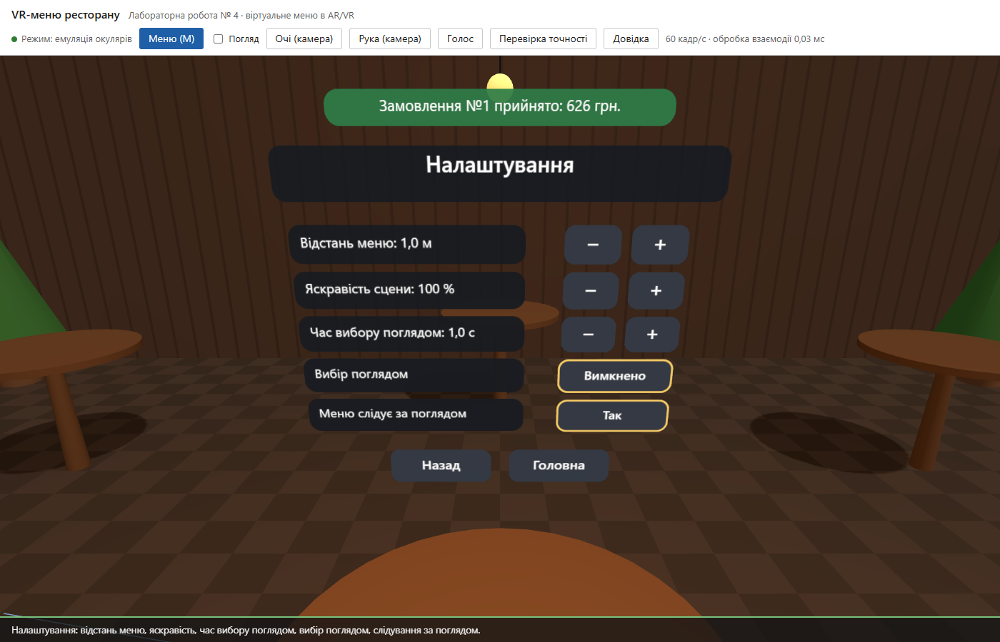

Користувач відвернувся — меню плавно переїжджає перед погляд:

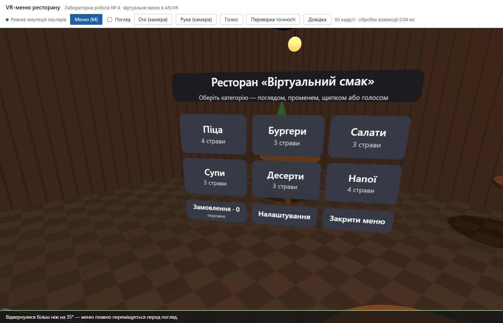

Перевірка точності: система підсвічує ціль, яку треба обрати заданим способом:

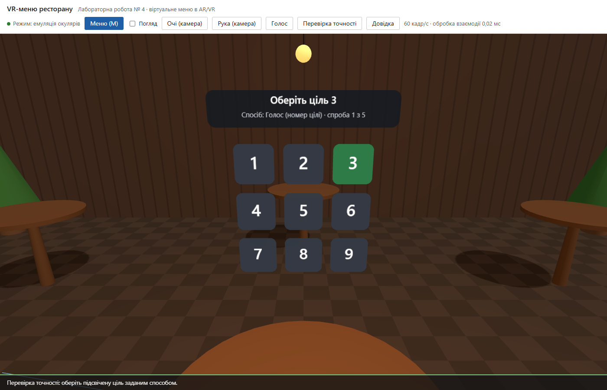

Результати перевірки точності (таблицю можна скопіювати):

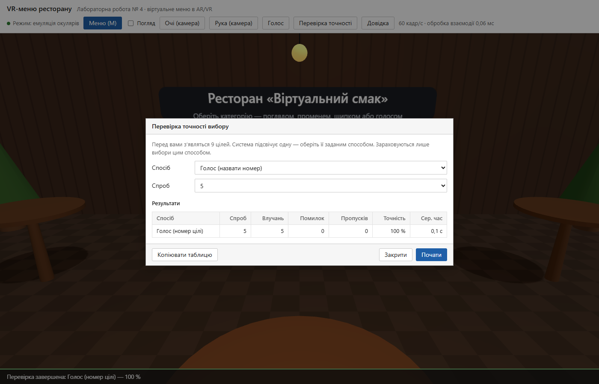

Довідка з керуванням:

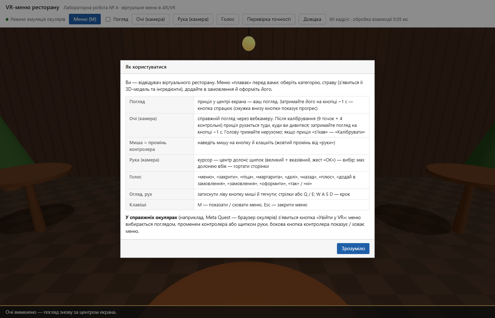

## 6. Безпека

| Загроза | Захист |
|---|---|
| Підробка суми замовлення | Клієнт надсилає лише id страв і кількість; ціни й суму сервер бере з бази |
| Некоректні дані | Валідація на сервері: 1–20 позицій, кількість — ціле число 1–20, страва має існувати в меню, спосіб — з дозволеного списку |
| SQL-ін’єкції | Параметризовані запити |
| XSS | Текст у сторінку виводиться через `textContent`, у 3D — малюється на canvas |
| Перевантаження | Тіло запиту до 8 КБ, зрозумілі відповіді на некоректний JSON |
| Конфіденційність | Відео з вебкамери (рука, очі) і мікрофон обробляються лише в браузері, зображення на сервер не надсилаються. Моделі MediaPipe працюють локально, хмарних ключів API немає. |
| Випадкові дії | Захист від «проблеми Мідаса» (розділ 5.4), підтвердження замовлення |

## 7. Тестування

### 7.1. Модульні тести (`npm test`) — 23 тести, усі пройдено

- модель меню: навігація, сторінки, кошик, обмеження кількості, оформлення лише з підтвердженням, налаштування та їхні межі;
- затримка погляду (спрацьовує один раз, скидається при зміні цілі);
- 23 голосові команди;
- жести руки на синтетичних кадрах: курсор, щипок, мах, кулак не вважається щипком;
- українські відмінки («1 порція», «3 порції», «5 порцій»);
- очі: ознаки на синтетичному обличчі (зіниця вправо / вниз, моргання), калібрування за 9 точками з шумом (похибка на контрольних точках), стійкість до невеликого повороту голови, перетворення пікселів у градуси, медіанний фільтр, фільтр One Euro, відсіювання викидів, вибір цілі за вікном 300 мс;
- REST API: серверний перерахунок суми, валідація, спосіб підтвердження.

### 7.2. Браузерні перевірки — 28 перевірок, усі пройдено

Chrome без вікна й без звуку керує застосунком через протокол DevTools.

**npm run test:e2e — 17 перевірок:**

| Що перевіряється | Результат |
|---|---|
| Сторінка запускається, меню (20 страв, 6 категорій) завантажено з сервера | ✔ |
| Промінь (справжні кліки миші): категорія, гортання, страва; «+» і «Додати» | ✔ |
| Погляд: через 0,6 с вибору ще немає, через 1,5 с — є | ✔ |
| Після зміни сторінки кнопка під поглядом не спрацьовує сама | ✔ |
| Вимкнений погляд нічого не обирає | ✔ |
| Рука: щипок обирає пункт під курсором, мах гортає сторінки | ✔ |
| Голос: категорія → страва → кількість → додати → замовлення | ✔ |
| Оформлення: «ні» скасовує, «так» зберігає в базі (сума 296 грн, спосіб `voice`) | ✔ |
| Підтвердження променем (кнопка «Так») | ✔ |
| Незрозуміла голосова команда не виконується | ✔ |
| Налаштування; меню переміщується за поглядом | ✔ |
| Режим перевірки точності рахує влучання й помилки | ✔ |
| Час обробки взаємодії за кадр < 20 мс | ✔ |
| Помилки в консолі | ✔ немає |

**npm run test:e2e:eyes — 11 перевірок очей:**

| Що перевіряється | Результат |
|---|---|
| Справжній Face Landmarker на фото обличчя (фальшива камера Chrome) знаходить обличчя й зіниці | ✔ h = 0,505, v = −0,001 (зіниці по центру ока) |
| Скасування калібрування вимикає очі й камеру | ✔ |
| Повне калібрування (13 точок) з імітованими очима, показ похибки в пікселях і градусах | ✔ 3–4 пікс. |
| Вибір очима через ~1 с, джерело «очі» | ✔ |
| Тремтіння (кожен 6-й кадр «вискакує» на сусідню кнопку) не заважає вибору | ✔ |
| Обличчя зникло — нічого не обирається | ✔ |
| Сервер приймає спосіб `eyes`; вимкнення очей повертає погляд «головою» | ✔ |
| Помилки в консолі | ✔ немає |

### 7.3. Точність вибору (вимога завдання — понад 90 %)

Точність виміряно автоматично в режимі «Перевірка точності». 9 цілей розміром 0,13 м із кроком 0,16 м на відстані 1 м (ціль ≈ 7,4°, крок ≈ 9,1°), кожного разу підсвічується випадкова ціль. Спроба йде через увесь справжній конвеєр застосунку (промені, затримка, фільтри, калібрування), а до наведення додається реалістичний шум:

| Спосіб | Шум наведення | Спроб | Влучань | Помилок | Пропусків | Точність |
|---|---|---|---|---|---|---|
| Погляд (голова) | σ = 1,5° | 20 | 20 | 0 | 0 | **100 %** |
| Промінь (миша) | σ = 12 пікс. | 20 | 20 | 0 | 0 | **100 %** |
| Рука (щипок) | σ = 25 пікс. | 20 | 19 | 1 | 0 | **95 %** |
| Голос (номер словом) | — | 20 | 20 | 0 | 0 | **100 %** |

Для очей шум задано як похибку айтрекера σ: постійний зсув у межах спроби («з’їхане» калібрування) плюс тремтіння кожного кадру.

| Похибка айтрекера σ | На екрані | Спроб | Влучань | Помилок | Пропусків | Точність | Сер. час вибору |
|---|---|---|---|---|---|---|---|
| 1° | ≈ 12 пікс. | 20 | 20 | 0 | 0 | **100 %** | 1,4 с |
| 2° | ≈ 25 пікс. | 20 | 19 | 1 | 0 | **95 %** | 1,4 с |
| 3° | ≈ 37 пікс. | 20 | 19 | 0 | 1 | **95 %** | 1,8 с |
| 4° | ≈ 50 пікс. | 20 | 17 | 2 | 1 | 85 % | 3,4 с |
| 5° | ≈ 62 пікс. | 20 | 12 | 6 | 2 | 60 % | 2,7 с |
| 6° | ≈ 75 пікс. | 20 | 13 | 4 | 3 | 65 % | 2,4 с |

Висновок: за похибки айтрекера до 3° вибір очима відповідає вимозі (понад 90 %). Половина цілі — близько 3,7°, тож коли похибка наближається до цього розміру, погляд дедалі частіше «сідає» на сусідню ціль. Середній час вибору — 1,4 с: це затримка 1 с плюс ~0,4 с на медіанний фільтр, вікно 300 мс і згладжування. Типова похибка вебкамери (1,5–4°) якраз потрапляє на межу, тому важливі якісне калібрування й великі кнопки. Похибку калібрування користувач бачить одразу на екрані результату.

Для голосу автоматичний тест перевіряє розбір команд, а не розпізнавання мовлення: якість Web Speech API залежить від мікрофона й вимови.

### 7.4. Ручні вимірювання автора

> Таблицю заповнює автор роботи: кнопка «Перевірка точності» → спосіб → «Почати» → після серії «Копіювати таблицю». Для способу «Очі через вебкамеру» спершу увімкнути «Очі (камера)» і пройти калібрування; його похибку записати окремо.

| Спосіб | Спроб | Влучань | Помилок | Пропусків | Точність | Сер. час |
|---|---|---|---|---|---|---|
| Погляд (затримка) | ___ | ___ | ___ | ___ | ___ % | ___ с |
| Очі через вебкамеру | ___ | ___ | ___ | ___ | ___ % | ___ с |
| Миша / промінь контролера | ___ | ___ | ___ | ___ | ___ % | ___ с |
| Рука (вебкамера, щипок) | ___ | ___ | ___ | ___ | ___ % | ___ с |
| Голос (номер цілі) | ___ | ___ | ___ | ___ | ___ % | ___ с |

Похибка калібрування очей (з екрана результату): середня ___ пікс. (≈ ___°), найбільша ___ пікс.

### 7.5. Тестування за відгуками та виправлення

| Відгук або знахідка | Рішення |
|---|---|
| Меню надто дрібне на екрані ноутбука | Відстань меню 1 м, поле зору камери 60° |
| Підписи інгредієнтів перекривали один одного | Розміщення дугою над моделлю |
| Текст кнопок навігації переносився | Менший шрифт кнопок |
| Погляд одразу обирав центральну картку на новій сторінці («проблема Мідаса») | Меню нижче рівня очей; після зміни сторінки кнопка під поглядом не спрацьовує, доки погляд з неї не зійде |
| Клік міг спрацювати по застарілому влучанню | Промінь перераховується в момент натискання |
| Замовлення, оформлені голосом, записувались як «миша» | Виправлено передачу способу в обробник дій |
| «1 порцій», «3 страв» | Узгодження числівників (`plural`) |
| Прохання: обирати меню справжнім поглядом очей через вебкамеру | Відстеження очей (розділ 5.5) |
| Калібрування надто швидке, приціл неточний | Довші точки (1 + 1,5 с) з лічильником і стисканням, відсіювання викидів, ознака розкриття очей, донавчання на 13 точках, живий приціл на екрані результату, вибір плавності |
| Одиночні «викиди» оцінки очей переводили приціл на сусідню кнопку | Медіанний фільтр перед One Euro і вибір цілі за вікном 300 мс |
| Вимкнений погляд усе одно підсвічував кнопку в центрі | Вимкнений погляд нічого не підсвічує |
| У перевірці точності перша ціль у центрі блокувалася захистом від Мідаса | Ціль, яку система запропонувала обрати, не блокується; цілі не повторюються поспіль |

### 7.6. Продуктивність (вимога — затримка < 20 мс)

- **Обробка взаємодії за кадр** (промені всіх вказівників, наведення, затримка, вибір цілі): середня **0,03 мс**, найбільша **0,2–0,5 мс**, що значно менше за 20 мс. Значення щосекунди видно в шапці сторінки.
- **Частота кадрів:** 55–60 кадр/с навіть у браузері без відеокарти (програмний GPU).
- **Розпізнавання обличчя й зіниць** Face Landmarker: 20–30 мс на кадр у браузері без відеокарти. Це окремий потік відео (~30 кадр/с), який не блокує кадри сцени. З відеокартою (делегат GPU) значно швидше.
- Текстури кнопок перемальовуються лише при зміні стану, а не щокадру.

## 8. Розгортання

```bash
npm install            # також завантажує моделі MediaPipe
npm start              # http://localhost:3003
npm test               # модульні тести
npm run test:e2e       # браузерні перевірки
npm run test:e2e:eyes  # перевірки відстеження очей
```

**Справжні окуляри (Meta Quest).** WebXR вимагає HTTPS або `localhost`. Окуляри з увімкненим режимом розробника підключаються кабелем, виконується `adb reverse tcp:3003 tcp:3003`, і в браузері окулярів відкривається `http://localhost:3003` → «Увійти у VR» або «Увійти в AR». Без окулярів можна встановити розширення Chrome **Immersive Web Emulator** (Meta): воно імітує Quest, і кнопка «Увійти у VR» з’являється у звичайному Chrome. Для публічного розгортання потрібен HTTPS-хостинг.

## 9. Висновки

1. Розроблено віртуальне 3D-меню ресторану в імерсивному просторі: плаваючі панелі, картки страв, 3D-моделі з інгредієнтами, замовлення з підтвердженням і налаштування. Оформлені замовлення зберігаються в базі даних разом зі способом підтвердження.
2. Реалізовано п’ять способів взаємодії через спільний механізм дій: погляд із затримкою ≥ 1 с (правило із завдання), промінь контролера, жести руки (MediaPipe), голос (Web Speech) і справжній погляд очима через звичайну вебкамеру з калібруванням.
3. Для справжніх окулярів використано відкритий стандарт WebXR (VR і AR, контролери, руки). Через відсутність окулярів основним режимом стала емуляція окулярів у браузері, яку дозволяє завдання. WebXR написано за специфікацією, але на реальних окулярах не перевірено — це наступний крок.
4. Відстеження очей вебкамерою (точки зіниць MediaPipe, калібрувальна регресія, медіанний фільтр і One Euro, вибір цілі за вікном) замінює айтрекер окулярів. Моделювання показало, що вибір кнопок меню лишається точнішим за 90 % за похибки айтрекера до ~3°, а типова похибка вебкамери — 1,5–4°.
5. Точність вибору в автоматичних вимірюваннях — 95–100 % для всіх способів (вимога — понад 90 %). Час обробки взаємодії — 0,03 мс у середньому, що значно менше вимоги 20 мс.
6. Захист від «проблеми Мідаса» (затримка, блокування кнопки під поглядом після зміни сторінки, меню нижче рівня очей, підтвердження) запобігає випадковим виборам — головному ризику інтерфейсів, керованих поглядом.
7. Якість підтверджено 23 модульними тестами й 28 браузерними перевірками.
